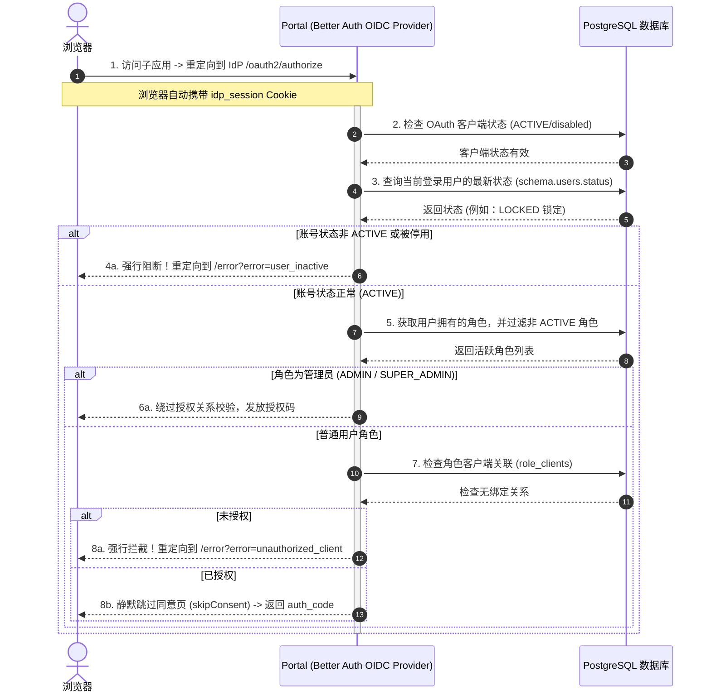
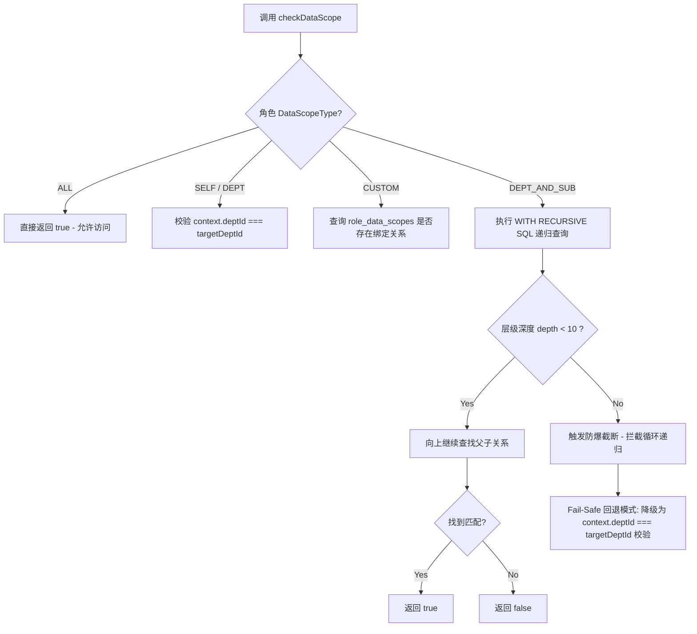

# Auth-SSO 设计系统

版本: v3.3
最后更新: 2026-10-22

---

## 概述

本文档定义 Auth-SSO 产品的视觉设计规范，确保跨页面的一致性和品牌识别度。

**设计原则:**
1. **专业可信**: 深蓝色主色调传达安全和专业
2. **现代精致**: Geist 字体 + 克制动效，摆脱"AI 生成感"
3. **数据优先**: 管理后台突出数据密度和操作效率
4. **中文优化**: 字体选择优先中文显示效果
5. **极简登录**: 登录页减少视觉元素，专注核心操作

> **⚠️ 架构章节时效声明（2026-09-30）**：本文档"OIDC 授权时序""数据沙箱""CTE 递归防死循环"等架构章节为 v2.1 时代（Better Auth / `role_clients` / `DataScopeType`）的历史快照，所述机制已被 ADR-001/002/006/007/008/010/012 取代——Portal 为自建 OIDC Provider、Client 准入经 `permissions.client_id` 链路、数据范围为角色部门子树（`ancestors` 物化路径，非 CTE 递归）。现行架构唯一真相源：`docs/spec/ARCHITECTURE.md` 与 `docs/adr/`。视觉设计规范章节（色彩/字体/组件规范）仍然有效。

---

## 颜色系统

> **v2.2 更新 (2026-06-26):** 全站颜色体系已统一为 oklch。以下 oklch 值与 `apps/portal/src/app/globals.css` 保持同步。
> 组件中应使用 Tailwind 工具类（`bg-primary-subtle`、`text-muted-foreground` 等），禁止硬编码 hex 或 oklch 原始值。

### 品牌色 (Brand — oklch)
| 变量名 | oklch 值 | 用途 |
|--------|---------|------|
| `--color-primary` | `oklch(0.52 0.23 257)` | 品牌蓝 — 按钮、链接、强调色 |
| `--color-primary-hover` | `oklch(0.43 0.21 257)` | 悬停/激活态 |
| `--color-primary-subtle` | `oklch(0.95 0.03 250)` | 浅背景、卡片悬停 |

### 背景色 (Background — oklch)
| 变量名 | 浅色模式 | 暗黑模式 | 用途 |
|--------|---------|---------|------|
| `--color-background` | `oklch(0.99 0.001 253)` | `oklch(0.18 0.02 260)` | 页面底色 |
| `--color-surface` | `oklch(1 0 0)` | `oklch(0.25 0.03 260)` | 卡片/面板背景 |
| `--color-surface-elevated` | `oklch(1 0 0)` | `oklch(0.32 0.03 260)` | 浮层/弹窗背景 |

### 文字色 (Text — oklch)
| 变量名 | 浅色模式 | 暗黑模式 | 用途 |
|--------|---------|---------|------|
| `--color-text-primary` | `oklch(0.18 0.02 260)` | `oklch(0.96 0.01 260)` | 标题、正文 |
| `--color-text-secondary` | `oklch(0.42 0.03 260)` | `oklch(0.68 0.03 250)` | 次要文字 |
| `--color-text-muted` | `oklch(0.68 0.03 250)` | `oklch(0.52 0.03 250)` | 辅助/禁用文字 |

### 语义色 (Semantic — oklch)
| 变量名 | oklch 值 | 用途 |
|--------|---------|------|
| `--color-success` | `oklch(0.67 0.17 165)` | 成功状态 |
| `--color-warning` | `oklch(0.72 0.17 80)` | 警告状态 |
| `--color-error` | `oklch(0.59 0.22 28)` | 错误状态 |
| `--color-info` | `oklch(0.55 0.22 257)` | 信息状态 |

### 边框 & 渐变
| 变量名 | 浅色模式 | 暗黑模式 | 用途 |
|--------|---------|---------|------|
| `--color-border` | `oklch(0.93 0.01 260)` | `oklch(0.32 0.03 260)` | 边框、分割线 |
| `--color-gradient-start` | `oklch(0.52 0.23 257)` | — | 登录页渐变起点 |
| `--color-gradient-end` | `oklch(0.35 0.17 257)` | — | 登录页渐变终点 |

### shadcn 基础体系（不可修改）

以下 shadcn 变量控制 UI 组件前景/背景语义，`--primary` 是**前景文本色**（非品牌蓝），不应修改：

```
--primary:         oklch(0.205 0 0)   (浅色) / oklch(0.922 0 0) (暗黑)
--primary-foreground: oklch(0.985 0 0) (浅色) / oklch(0.205 0 0) (暗黑)
--muted:           oklch(0.97 0 0)    (浅色) / oklch(0.269 0 0) (暗黑)
--muted-foreground: oklch(0.556 0 0)  (浅色) / oklch(0.708 0 0) (暗黑)
```

### 使用规则

- **组件中始终使用 Tailwind class**（`bg-primary-subtle`、`text-muted-foreground`），不直接引用 CSS 变量
- **禁止硬编码 hex 或 oklch 原始值**在 TSX 中（如 `bg-[#E6F0FF]`）——这绕过暗黑模式切换
- **设计新组件时**，颜色选择从已有 design token 中选取，不新增任意颜色值

---

## 字体规范

### 字体家族

| 类型 | 字体 | 说明 |
|------|------|------|
| 中文 | "PingFang SC", "Microsoft YaHei", sans-serif | 中文显示优先 |
| 英文 | "Geist", -apple-system, BlinkMacSystemFont, sans-serif | 现代科技感 |
| 等宽 | "JetBrains Mono", "Fira Code", monospace | 数据、代码 |

**字体加载 (Google Fonts):**

```html
<link href="https://fonts.googleapis.com/css2?family=Geist:wght@400;500;600;700&display=swap" rel="stylesheet">
<link href="https://fonts.googleapis.com/css2?family=JetBrains+Mono:wght@400;500&display=swap" rel="stylesheet">
```

### 字号规范 (更新)

| 名称 | 字号 | 行高 | 用途 |
|------|------|------|------|
| xs | 12px | 16px | 辅助文字、标签 |
| sm | 13px | 20px | 表格、列表项 — 更紧凑 |
| base | 15px | 24px | 正文 — 比 16px 更现代 |
| lg | 17px | 28px | 副标题 |
| xl | 21px | 28px | 卡片标题 |
| 2xl | 27px | 36px | 页面标题 |
| 3xl | 35px | 40px | 大标题 |
| 4xl | 45px | 52px | 登录页品牌名 |

### 字重规范

| 名称 | 值 | 用途 |
|------|-----|------|
| regular | 400 | 正文 |
| medium | 500 | 表格标题、按钮 |
| semibold | 600 | 卡片标题、导航 |
| bold | 700 | 页面标题、品牌名 |

---

## 间距系统

### 基础间距 (基于 4px)

| 名称 | 值 | 用途 |
|------|-----|------|
| 0 | 0px | - |
| 1 | 4px | 紧凑元素间距 |
| 2 | 8px | 图标与文字间距 |
| 3 | 12px | 列表项内间距 |
| 4 | 16px | 卡片内间距、表单字段间距 |
| 5 | 20px | 卡片间距 |
| 6 | 24px | 区块间距 |
| 8 | 32px | 页面区块间距 |
| 10 | 40px | 页面内边距 |
| 12 | 48px | 页面顶部间距 |
| 16 | 64px | 页面底部间距 |

### 布局规范

| 元素 | 值 |
|------|-----|
| 页面内边距 | 24px (移动端) / 40px (桌面) |
| 卡片内边距 | 24px |
| 卡片间距 | 24px |
| 表单字段间距 | 16px |
| 按钮间距 | 12px (组内) / 24px (组间) |
| 导航高度 | 64px (顶部) / 240px (侧边栏展开) |
| 最大内容宽度 | 1440px (管理后台) / 400px (登录页) |

---

## 圆角系统

采用分层圆角，避免视觉单调：

| 名称 | 值 | Tailwind | 用途 |
|------|-----|----------|------|
| sm | 6px | `rounded-lg` | 标签、小按钮 |
| md | 8px | `rounded-lg` (shadcn default) | 按钮、输入框 |
| lg | 12px | `rounded-xl` | 卡片、面板、指标卡 |
| xl | 16px | `rounded-2xl` | 模态框、推广卡片、侧边栏 |
| full | 9999px | `rounded-full` | 徽章、头像 |

---

## 动效系统

### 动效原则

- **克制功能性**: 动效服务于理解，不为装饰而动
- **快速响应**: 用户操作立即得到视觉反馈
- **自然流畅**: 使用合适的缓动曲线

### 缓动曲线

```css
--ease-out: cubic-bezier(0.16, 1, 0.3, 1);      /* 进入动画 */
--ease-in: cubic-bezier(0.7, 0, 0.84, 0);        /* 退出动画 */
--ease-in-out: cubic-bezier(0.87, 0, 0.13, 1);   /* 移动动画 */
```

### 持续时间

| 名称 | 值 | 用途 |
|------|-----|------|
| fast | 100ms | 按钮悬停、开关切换 |
| normal | 200ms | 下拉菜单、面板展开 |
| slow | 300ms | 页面过渡、模态框 |

### 应用场景

| 场景 | 动效 | 持续时间 |
|------|------|----------|
| 按钮悬停 | 背景色渐变 | 100ms |
| 输入框聚焦 | 边框颜色 + 外发光 | 100ms |
| 下拉菜单 | 高度展开 | 200ms ease-out |
| 模态框 | 淡入 + 轻微上移 | 200ms |
| Toast 通知 | 从右侧滑入 | 300ms |
| 卡片悬停 | 上移 4px + 阴影 | 200ms ease-out |

---

## 组件规范

### 按钮

**尺寸:**

| 名称 | 高度 | 水平内边距 | 字号 |
|------|------|-----------|------|
| sm | 32px | 12px | 14px |
| md | 40px | 16px | 14px |
| lg | 48px | 24px | 16px |

**变体:**

| 名称 | 样式 | 用途 |
|------|------|------|
| primary | 主色背景 + 白色文字 | 主要操作 |
| secondary | 透明背景 + 主色边框 + 主色文字 | 次要操作 |
| ghost | 透明背景 + 次要文字 | 辅助操作 |
| danger | 红色背景 + 白色文字 | 危险操作 |

**圆角:** 8px (默认) / 6px (紧凑)

**悬停态:**
- Primary: 背景色加深 (--color-primary-hover)
- Secondary: 背景色填充 (--color-primary-subtle)
- Ghost: 背景色填充 (--color-surface-elevated)

### 输入框

| 属性 | 值 |
|------|-----|
| 默认高度 | 40px |
| 登录页高度 | 48px |
| 圆角 | 8px |
| 内边距 | 12px 16px |

**状态:**

| 状态 | 边框色 Token | 背景 Token |
|------|------------|----------|
| default | `border-border` | `bg-muted/50` |
| focus | `ring-2 ring-primary/10` | `bg-card` |
| error | `border-destructive` | `bg-destructive/10` |
| disabled | `border-border` | `bg-muted` |

**聚焦外发光:**

```css
focus:ring-2 focus:ring-primary/10
```

### 卡片

| 属性 | 值 |
|------|-----|
| 背景 | `bg-card` |
| 边框 | `ring-1 ring-border/50` |
| 圆角 | 12px (`rounded-xl`) |
| 阴影 | 无或 `shadow-sm` |
| 内边距 | 24px |

**悬停态 (可选):**

```css
hover:shadow-md hover:-translate-y-0.5 transition-all duration-200
```

### 数据表格 (DataTable)

DataTable 是共享表格组件，所有列表页统一使用。

**表格行密度:**

| 属性 | 值 |
|------|-----|
| 行高 | **48px 起（`h-12`）/ 多行自然增高**；同一表格内行高必须一致 |
| 单元格内边距 | **8px 16px (`px-4 py-2`)**；多行内容靠 `leading-tight` 收在 48px 内 |
| 表头高度 | **40px (`h-10`)** |
| 表头字号 | 10px `font-black uppercase tracking-widest` |
| 表头颜色 | `text-muted-foreground` |
| 表头背景 | `bg-muted/50` |
| 数据行字号 | 14px (`text-sm`)；次要信息 12px (`text-xs`) |
| 圆角 | 12px (`rounded-xl`) — 同 Card |

**操作按钮（行内，必须可见）:**

| 属性 | 值 |
|------|-----|
| 形态 | **行内图标按钮直接渲染**，禁止再收进「⋯」下拉（此前"表格操作都是隐藏的"是明确返工项） |
| 尺寸 | 32×32px (`h-8 w-8` / `size="icon-sm"`) |
| 圆角 | 8px（`rounded-lg`） |
| 变体 | `ghost`；危险操作仅图标用 `text-destructive`，hover `bg-destructive/10` |
| 可访问性 | 每个按钮必须 `aria-label` + `title`（图标按钮无文字） |
| 列宽 | 操作列右对齐，图标间距 2px；用户/角色/应用 3 个以内，权限 2 个 |

**空状态:**

- 无数据 → `EmptyState` simple variant + 图标 + 描述 + CTA 按钮
- 首次使用 → `EmptyState` onboarding variant + 步骤 Checklist

**列表页工具条（`TableToolbar`，唯一实现）:**

| 属性 | 值 |
|------|-----|
| 容器 | `border-b bg-muted/50 px-6 py-3`，与表格卡片同宽 |
| 布局 | 左槽 = 搜索 + 筛选；右槽 = 统计 + 主操作；md 以上两端对齐，窄屏纵向堆叠 |
| 搜索框 | `SearchInput` 唯一实现：`w-full md:w-80` + 内置清空按钮（`aria-label="清空搜索"`）|
| 筛选器 | `SelectTrigger` 统一 `w-40`；不得使用本页自绘搜索框/自绘清空按钮 |
| 控件尺寸 | 工具条内 Input/Select/Button **全部 40px 高**（组件审计逐页断言）|
| 页签 | Tab/分段控件**不放进工具条**，独立成行（权限管理、审计日志同形态）|

**分页器（"分页出现在滚动之后"是明确返工项）:**

| 属性 | 值 |
|------|-----|
| 位置 | 表格卡片底部，`-mt-px` 与卡片贴合，`bg-muted/50` 背景 |
| 首屏可见 | 列表页分页必须**无需滚动页面**即可看到：页面高度 ≤ 视口高度 |
| 表格滚动 | 放置不下时由**表格内部滚动**承载（`max-h` 按页面形态：无页签 `calc(100vh-21rem)`、权限页 `calc(100vh-30rem)`、审计页 `calc(100vh-25rem)`）|
| 吸顶表头 | 滚动容器内 `TableHeader` 必须 `sticky top-0 z-10`，滚动时列头不丢 |
| 页码按钮 | `h-8 w-8 rounded-lg` |
| 页码指示器 | `bg-card border border-border rounded-lg` |

### 按钮圆角（全局统一）

| 元素 | 圆角 | Tailwind |
|------|------|----------|
| 操作/工具栏按钮 | 8px | `rounded-lg` |
| 卡片容器 | 12px | `rounded-xl` |
| 对话框 | 16px | `rounded-2xl` |
| 输入框/表单控件 | 8px | `rounded-lg` |

### 提示信息 (Alert)

| 类型 | 背景 | 文字 |
|------|------|------|
| success | #D1FAE5 | #065F46 |
| warning | #FEF3C7 | #92400E |
| error | #FEE2E2 | #991B1B |
| info | #DBEAFE | #1E40AF |

**样式:**
- 内边距: 12px 16px
- 圆角: 8px
- 字号: 14px

### 状态徽章 (Badge)

| 类型 | 背景 | 文字 |
|------|------|------|
| active | #D1FAE5 | #059669 |
| disabled | #FEE2E2 | #DC2626 |
| pending | #FEF3C7 | #D97706 |

**样式:**
- 内边距: 4px 10px
- 圆角: full (9999px)
- 字号: 11px
- 字重: 500

---

### 实现约定（2026-10-20 组件统一后，与 `globals.css` 同步）

> 这一节是**可执行口径**：`apps/portal` 的基类与页面覆写必须落在下表内，
> 超出即视为漂移（`.ui-audit/component-audit.mjs` + `component-score.mjs` 会逐组件打分）。

**圆角 token 映射（`globals.css`）**

| Tailwind | 计算值 | 用途 |
|---|---|---|
| `rounded-sm` | 6px | 极小标签 |
| `rounded-md` | 8px | 按钮 / 输入框 / 行内图标按钮 / 下拉条目 |
| `rounded-lg` | 8px | 表单控件（与 md 等价，基类统一用它） |
| `rounded-xl` | 12px | 卡片、表格容器、页签容器 |
| `rounded-2xl` | 16px | 对话框 |
| `rounded-full` | 9999px | 徽章、头像 |

**控件尺寸（唯一口径）**

| 元素 | 尺寸 | 说明 |
|---|---|---|
| Input / Select / Textarea | 40px 高；圆角 8px；边框 `border-input`；背景透明（继承承载面） | 聚焦：`border-ring + ring-3 ring-ring/50`，**不使用** ring-offset |
| 登录页输入框 / 主按钮 | 48px 高 | 登录页专属，提高首次触达面积 |
| Button `sm / default / lg` | 32 / 40 / 48px | 图标按钮：`icon`=40、`icon-sm`=32；工具栏主操作必须 `default`（40）与输入框齐平 |
| Badge | 11px / `font-medium` / `px-2.5 py-0.5` / `rounded-full` | 状态必须经 `lib/status-label` 中文化，禁止直出 `ACTIVE` 等枚举 |
| Tab | 容器 40px（`h-10 p-1 bg-muted rounded-lg`）；触发器 32px（`h-8 px-3 rounded-md`） | 所有页签同一形态；服务端页签用同款样式的 `Link` |
| DropdownMenu | 面板 12px 圆角 `p-1`；条目 36px `rounded-lg`；分组标题 10px 大写 `text-muted-foreground` | 页面不再覆写菜单圆角/内边距 |

**容器**

| 元素 | 口径 |
|---|---|
| Card | 12px 圆角；内边距 24px（`py-6` + `CardHeader/CardContent px-6`）；表格卡用 `CardContent p-0` 例外 |
| Dialog | 宽 448px（`sm:max-w-md`）、16px 圆角、24px 内边距；`DialogFooter` 由基类提供「上边框 + `bg-muted/50` + 右对齐按钮」；**页面不再覆写宽度/圆角/内边距** |
| Table | 表头 44px、10px `font-black uppercase tracking-widest text-muted-foreground`；单元格 `px-4 py-4`（单行约 52px，多行自然增高）；行内操作 32×32；分页统一用 `shared/table-pagination` |
| PageHeader | 24px/700 标题 + 描述 + 右侧操作（操作按钮 40px） |
| Toast | sonner 默认位置/宽度，不逐页定制 |

**页面长度与数据真实性（2026-10-20 补）**

- 列表页**必须分页**（每页 ≤ 20；权限点这类可到数百条的列表用 15/页 + 统一分页器），
  不允许"一页滚不到底"；详情/个人中心的超长清单必须折叠（默认 12 项 + 展开全部）。
- **禁止占位/假数据**：Tab 里不允许放"设备身份校验已启用"这类不来自后端的静态卡片；
  要么接真实数据（例：个人中心会话记录读 `refresh_tokens` + JWT claims），要么不展示。

**服务端 / 客户端边界规则（2026-10-22，Next.js 16 + React 19）**

- **身份与权限快照只过一次边界**：服务端布局取到的 `roleCodes/permissionCodes` 经
  `<PermissionsProvider>` 传给客户端；客户端 `usePermissions` 同步读取，**禁止**再为同一份数据发
  `/api/me/permissions`（会产生会话级多余请求 + 首帧 `loading` 隐藏受保护入口 + SSR HTML 缺按钮）。
- **列表数据服务端取**：分页/搜索/权限/数据范围都在 Server Component 的 `data.ts` 完成；客户端只负责交互。
- **写操作走 Server Action**：Controller 只做编排/映射，权限、数据范围、审计在服务端；客户端隐藏入口只是 UX。
- **客户端 fetch 仅限用户触发**：对话框打开后才加载候选数据（权限/角色/成员/Token），并且必须有
  loading/空态/错误 toast；不得在布局/首屏 useEffect 拉取服务端已持有的数据。
- **权限读取与操作权限匹配**：需要“读取候选数据以完成某操作”的端点，应接受该**操作权限**或读取权限
  （如 `/api/roles` 接受 `role:list` 或 `user:assign_role`），不要逼操作员额外持有无关的管理权限。
- **破坏性操作必须显示影响面**：级联删除（如权限删除）的确认弹窗要按需读取并展示受影响角色/用户/
  子节点数量；影响面加载失败不得阻断操作，但必须在弹窗中说明“影响未知”。
- **发布验收包含边界回归**：`scripts/docker/stack.sh e2e` 运行 `tests/e2e` 全部 spec；新增的服务端/客户端
  边界行为（如权限快照零请求、SSR 按钮）必须有 E2E 或单测钉住。

**生产交付规则（2026-10-22）**

- 生产 Compose **不得向宿主机发布** PostgreSQL/Redis 端口；数据库仅 Compose 内网可达。
- 迁移 + seed 必须由一次性 `db-init` 服务在应用启动前完成（幂等），Portal 通过
  `depends_on: service_completed_successfully` 等待；Portal/Gateway 必须有健康检查与启动依赖。
- 部署统一走 `scripts/docker/deploy.sh`（`--check` / 默认 / `--no-build` / `--status` / `--down` / `--rollback`）；
  脚本失败必须退出非 0 并打印日志，不得静默成功；`--rollback` 只回镜像，数据库回退需显式备份恢复。
- Gateway 提供 `/healthz` 自身存活探针（不查 Redis、不访问 Portal），部署脚本先等它再等 `/login`；
  可复现基准：`node scripts/bench/gateway.mjs`。

**权限模型规则（2026-10-21 权限设计审计）**

- **角色准入**：非管理员角色必须至少有一个带 `clientId` 的**API** 权限（`permissions.client_id`）
  才能通过 OAuth 授权准入；`portal:*` 权限视为可访问 portal（数据层兜底，因 `DIRECTORY/PAGE`
  菜单权限受 CHECK 约束必须 `client_id IS NULL`）。seed 与迁移必须为 `portal:*` API 权限写入 `portal`。
- **唯一路由权限源**：`lib/route-access.ts` 的 `ROUTE_ACCESS` 同时驱动 layout 守卫与菜单过滤；
  菜单“看得见”必须等于“打得开”。禁止再维护第二套菜单权限判断，也禁止在动态菜单为空时回退全量内置菜单。
- **工作台是登录落地页**：对所有已登录用户开放（数据按范围裁剪）；跨部门敏感区块（审计动态）
  必须要求独立权限（`audit:read`）才查询/渲染；快捷入口按各自 CREATE/LIST 权限裁剪。
- **前端入口必须 `PermissionGuard`**：列表行内操作、详情页按钮、导出按钮都按 Server Action 所需权限隐藏。
  客户端隐藏只是 UX，服务端 `withAuth` 仍是唯一门禁。
- **错误状态码必须是实例字段**：`DomainError.status` 随对象携带，禁止按 `constructor.name` 查表映射
  （生产压缩会重命名类，导致 403/404/409/422 全退化为 400）。
- **403 视图规范**：图标 + 标题 + 原因 + “返回工作台”；登录失败错误码必须映射为中文可执行提示。
- **只读详情**：详情页读取权限（`user:read`/`client:read`）与编辑权限（`user:update`/`client:update`）分离；
  无编辑权限时用 `<fieldset disabled>` + 只读横幅，隐藏保存/撤销等写入口，不能“可改但无入口提交”。
- **分配候选列表**：角色/权限候选必须按页拉全量（服务端 pageSize 有上限），并只列 ACTIVE/范围内项。

**规模数据规则（2026-10-21，201 用户 / 345 权限 / 25k 日志实测）**

- **分页必须能"到达任意页"**：351 页时只给上一页/下一页等于不可用。统一分页条必须包含
  首页/末页、页码窗口（1 … 当前±1 … 末页）、跳页输入（客户端 `<PaginationJump>`；服务端用 GET form）。
  分页条内控件为**紧凑 32px**（与页码按钮同高），是"控件 40px"规则的唯一例外，输入需带 `data-compact`。
- **导出必须全量**：导出接口按页循环取全量（并声明上限，如 10 万行），不得只导第 1 页（MAX_PAGE_SIZE）；
  筛选条件必须透传。
- **大批量候选必须可全量加载**：对话框请求 list API 时不能假设单页返回所有数据（服务端 pageSize 有上限）；
  超过 200 项必须提供搜索/分组，并循环分页加载全量。
- **大表必须有类型/状态筛选**：25k 审计只有 tab 不可用；筛选写 URL（可分享/可刷新），并与分页/导出共用。
- **表格长文本必须 `truncate + title`**：名称/邮箱/编码/URL 列不得撑宽表格把操作列推出屏幕；
  实测容器 1136px 时应用表会被撑到 1452px。
- **树必须真折叠**：展开状态决定可见行（不是只换图标）；提供展开全部/收起全部；搜索时保留命中节点的祖先链。
- **组合组件不得嵌套交互元素**：`<TooltipTrigger>{button}</TooltipTrigger>` 会产生 `<button><button>`，
  浏览器解析后 outer 被自动闭合 → hydration mismatch（React #418，实测只在菜单出现"带子节点的目录"时触发）。
  必须用 `render`/`asChild` 合并到同一元素。
- **构建必须离线可复现**：禁止 `next/font/google`（构建期联网，实测导致 Docker build 失败）；
  字体用 `next/font/local` + `public/fonts/*.woff2`。

**布局与间距体系（2026-10-21 设计打磨）**

- **应用壳固定视口高度**：`SidebarProvider h-svh overflow-hidden`；`#main-content` 自身是唯一滚动容器。
- **列表页填满主内容区**：wrapper `flex flex-1 flex-col gap-6 min-h-0`；`DataTable fill` 模式（卡片 flex-1、
  表格内部滚动、表头 sticky、分页固定在卡片底部）。禁止再用 `max-h-[calc(100vh-30rem)]` 这类估算高度。
- **详情页主操作放 PageHeader 右侧**（保存=主按钮，禁用/危险切换=outline 危险色）；主操作不得落在首屏之外。
- **间距只有六档**：4 / 8 / 12 / 16 / 24 / 32 px。区块间距 24、卡片内边距 24、栅格间距 24；
  禁止 `gap-8`（32）、`px-8`、`p-8`、`pt-8` 这类孤例（错误页统一 `pt-6`）。
- **空状态页居中**：引导/空态在可用区域内垂直居中，不顶部对齐留整屏空白。

**查询架构（分清客户端/服务端）**

- 列表页的**搜索、过滤、分页必须服务端完成并写进 URL**（`page/type/keyword`），支持刷新/后退/分享；
  数据层用 `withPagination`，页大小 ≤ 20。
- 客户端过滤只允许两种场景：① 树结构（部门树需要整体加载）；② 对话框内的候选搜索（角色权限勾选）。
- 列表数据量增长时不得改回“全量下发 + 浏览器过滤”。

**按钮文字与中文优先**

- 行内操作、分页、复制等操作按钮**必须有可见中文文字**（图标+文字）；纯图标只允许用于
  通用且无歧义的控件（关闭 X、侧栏折叠、树展开箭头、输入框内清空），且必须有 `aria-label` + `title`。
- UI 文案中文优先：界面 chrome（标题/按钮/状态/说明/无障碍标签）一律中文；
  仅协议与凭据名词保留英文（OAuth、OpenID Connect、Client ID/Secret、Token、Scopes、CSV、URL），
  品牌副标（Identity OS）与编码值（`SUPER_ADMIN`、`portal:user:list`、`ROOT`）保留原样。

**关键凭据与操作可达性硬规则（防回归，2026-10-21 逐按钮审计）**

- **Portal 自身客户端只读**：`PORTAL_CLIENT_ID` 是登录链路凭据，管理面禁止修改/禁用/注销/轮换 Secret；
  服务端 `guardPortalSelfClient()` 必须拦（仅 UI 禁用不算），列表与详情按钮同时 disabled 并给出原因。
  实测轮换 `portal` Secret 会导致 Gateway `invalid_client`、全站用户被踢回登录页且无法再登录。
- **复制类操作必须可失败**：`navigator.clipboard` 在无头/iframe/非安全上下文会 reject。必须 `await` +
  回退（`execCommand`）+ **失败提示**；禁止 fire-and-forget 后无条件显示“已复制”。
- **Tab 必须可寻址**：影响内容的 Tab 状态同步到 URL（`?tab=`），支持深链/刷新/浏览器后退。
- **同一能力唯一入口 / 文案统一**：详情页不得用两个按钮打开同一个对话框；保存按钮统一叫「保存修改」
  （不再出现「保存更改 / 保存 / 保存修改」三种）。
- **领域禁止的操作不出现在 UI**：根部门删除、系统角色编辑/删除等 guard 会拒绝的动作，UI 直接不渲染。
- **危险操作按钮不得用实心红主按钮**：状态切换/注销用 `outline + 危险色`，主按钮只保留保存类动作。

**输入与路由参数硬规则（防回归）**

- **长度上限必须双层**：领域 Zod Schema `.max()` 对齐数据库列宽（`varchar(n)`），表单再加 `maxLength`。
  缺任一层都会让超长输入以 `22001 value too long` 变成 500（实测 300 字符角色名 → "服务器内部错误"）。
- **查询参数不得下沉成数据库错误**：枚举型 query（如 `?status=`、`?type=`）必须先经白名单，非法值回退默认，
  否则会触发 PG `22P02 invalid input syntax for type enum`（实测 `/users?status=BOGUS` 500）。
- **详情页路由参数先校验再查询**：UUID 列（users 等）先 `isUuid()`，非法即 `notFound()`；
  业务 ID 列（如 `clients.id = client_xxx`）**不得**套 UUID 规则（会把正常数据判成不存在）。
- **安全网**：`mapServerError` 需把 PG `22001/22P02/23514` 映射为 422 校验错误，而不是 500。

**服务间响应硬规则**

- 边界 401 必须带可判别 JSON 错误信封（`{ error, message }`）；只有 `WWW-Authenticate` 的空 401
  会让 API 调用方无法区分“未认证/过期”。HTML 导航仍走网关 302 授权链路，不返回 401。

**交互硬规则（防回归）**

- **禁止原生 `confirm()` / `alert()`**：二次确认一律用设计系统 `Dialog`（含标题/危险说明/取消+确认按钮）。
  原生弹窗在自动化、嵌入 WebView、部分 PWA 里会被拦截 ⇒ 用户看到的是"点了没反应"。
- **`<form action={serverAction}>` 的字段必须受控**：React 19 在 action 结束后会 reset 非受控表单，
  校验失败时用户已填内容会被清空，再次提交会被 HTML5 `required` 静默拦截（实测"新建用户"重复邮箱后的死路）。
  失败必须保留输入，成功后再清空。

**展示口径（防回归）**

- 日期/时间一律经 `lib/format-date`（固定 `zh-CN` + `Asia/Shanghai`），**禁止**裸 `toLocaleDateString/toLocaleTimeString`（服务端容器时区/ locale 与浏览器不同会导致 hydration 不一致）。
- 状态枚举一律经 `lib/status-label`（`accountStatus` / `enableStatus`）。
- 禁止硬编码调色板类（`text-blue-500`、`bg-slate-50` 等），用语义 token（`text-primary` / `bg-muted` / `text-warning`）；唯一例外是 DESIGN 明确给出的语义徽章色。
- 中文优先：不写「正常 (Active)」「登录账号 (Username)」这类双语标注；技术专名（Client ID / OAuth / Token）保留英文。

## 页面布局

### 登录页

```
┌─────────────────────────────────────────────┐
│                                             │
│         渐变背景 (#0066FF → #003399)         │
│                                             │
│     ┌─────────────────────────┐             │
│     │                         │             │
│     │       Auth-SSO          │  ← 品牌名   │
│     │   企业统一身份认证平台    │  ← 副标题  │
│     │                         │             │
│     │   ┌─────────────────┐   │             │
│     │   │ 用户名          │   │  ← 输入框  │
│     │   └─────────────────┘   │             │
│     │   ┌─────────────────┐   │             │
│     │   │ 密码            │   │             │
│     │   └─────────────────┘   │             │
│     │                         │             │
│     │   ┌─────────────────┐   │             │
│     │   │      登录       │   │  ← 主按钮  │
│     │   └─────────────────┘   │             │
│     │                         │             │
│     └─────────────────────────┘             │
│              白色卡片，阴影                   │
│                                             │
└─────────────────────────────────────────────┘
```

- 垂直居中布局
- 最大宽度 400px
- 白色卡片 + 柔和阴影 + 深色背景上的白色描边（`ring-white/20`）
- **动态品牌背景**（2026-10-20 返工：此前整屏高饱和亮蓝非常丑）：
  - 深海军蓝 → 品牌蓝纵向渐变（`#04122B → #0A2E63 → #0B3C86 → #050D1F`）；
  - 3 团低速漂移极光（蓝/青/湖绿，`lighter` 叠加，**不用紫色**）+ 细网格 + 微粒星点 + 四周暗角；
  - 实现为**零依赖 Canvas 2D**（`login/login-background.tsx`），不引入 PixiJS：纯装饰层不值得
    +150–400KB JS/WebGL 上下文；DPR ≤2、30fps 节流、`document.hidden` 暂停、
    `prefers-reduced-motion` 只画静态一帧、`aria-hidden`；
  - 文字在深底上用白色/`white/45`，卡片保持白底保证输入对比度。

### 管理后台

```
┌─────────────────────────────────────────────────────────┐
│ 顶部导航 (64px)                                          │
├──────────┬──────────────────────────────────────────────┤
│          │ 面包屑 > 页面标题              [操作按钮]     │
│ 侧边栏   ├──────────────────────────────────────────────┤
│ (240px)  │                                              │
│          │  ┌──────────┐ ┌──────────┐ ┌──────────┐      │
│ ▸ 工作台 │  │ 用户总数  │ │ 今日登录  │ │ 活跃应用  │      │
│   用户   │  │   1,234  │ │    856   │ │    12    │      │
│   部门   │  └──────────┘ └──────────┘ └──────────┘      │
│   角色   │                                              │
│   应用   │  ┌─────────────────────────────────────┐     │
│   日志   │  │ 表格数据...                          │     │
│          │  │                                      │     │
│          │  └─────────────────────────────────────┘     │
└──────────┴──────────────────────────────────────────────┘
```

- 顶部导航 (64px) + 侧边栏 (240px 可折叠) + 工作区
- 工作区最大宽度 1440px
- 数据密度优先

---

## 反 AI 模板规则

### 禁止使用的模式

| 模式 | 问题 | 替代方案 |
|------|------|---------|
| 紫色渐变背景 | 千篇一律的 SaaS 风格 | 品牌主色调渐变或纯色 |
| 3列特性卡片+图标 | 典型 AI 生成布局 | 功能导向的信息架构 |
| 居中对称布局 | 缺乏层次感 | 左右不对称布局突出重点 |
| 统一大圆角 | 视觉单调 | 分层圆角 (sm/md/lg) |
| 装饰性浮动元素 | 无意义的视觉噪音 | 功能性装饰 |
| emoji 作为设计元素 | 不够专业 | 图标库或自定义图标 |
| Inter 字体 | 滥用导致缺乏辨识度 | Geist / Satoshi 等现代字体 |
| 渐变按钮 | 过度装饰 | 纯色按钮 + 悬停变化 |

---

## 技术架构与核心安全设计

### 1. OIDC 强拦截与状态双重防卫机制

在 Auth-SSO 系统中，为了防范“账户中途被停用/锁定，但仍可利用旧会话进入子系统”以及“普通用户越权访问未授权子应用”的经典安全漏洞，IdP 在授权码发放阶段实施了双重强拦截防卫：
- **实时状态核准**：每次 OAuth 授权请求均会实时穿透查询数据库中用户的最新状态（Active/Disabled/Locked），对非 Active 状态进行强行阻断。
- **动态应用准入**：除超级管理员（SUPER_ADMIN）外，普通用户必须绑定了包含目标客户端的角色关系，否则拒绝准入并重定向至未授权错误页。



### 2. 数据沙箱部门级联与 CTE 递归防死循环

为了支撑精细化数据隔离需求（`ALL` / `DEPT` / `DEPT_AND_SUB` / `SELF` / `CUSTOM`），系统在底层 ORM 执行 SQL 时强制通过中间件注入沙箱判定。
在 `DEPT_AND_SUB` （本部门及子部门）的层级检索中，采用 PostgreSQL 的 `WITH RECURSIVE` 递归查询，并引入了“双重安全防爆与 Fail-Safe 降级”策略，从根源上杜绝因脏数据导致无限递归拖垮数据库的隐患（Infinite Loop DoS）：



### 3. 核心技术亮点沉淀

#### 3.1 递归深度截断与 Fail-Safe 闭环 (安全纵深防御)
在通过 `DEPT_AND_SUB` 递归检查子部门时，系统编写了非常专业的递归 CTE：
```sql
WITH RECURSIVE sub_depts AS (
  SELECT id, 1 as depth FROM departments WHERE id = ${context.deptId}
  UNION ALL
  SELECT d.id, sd.depth + 1 FROM departments d
  INNER JOIN sub_depts sd ON d.parent_id = sd.id
  WHERE sd.depth < 10
)
```
1. **防爆截断**：通过 `sd.depth < 10` 的强制限制，在底层预防了因组织架构环形引用而导致数据库进程彻底死锁的灾难。
2. **Fail-Safe 降级**：若发生任何未预料的底层数据库报错，系统会自动捕获异常并降级回退至 `context.deptId === targetDeptId` 的严格比对，确保安全防线的可用性。

#### 3.2 “孤儿节点自动升顶”优化 (树状渲染容错)
在数据沙箱隔离模式下，当上级部门由于越权被隐藏时，直接使用 `parentId` 会导致子部门在前端“彻底失联且无法渲染”。
系统在构建部门树时动态校验：**如果某个节点的父节点不在用户的授权数据范围内，该子节点自动升级成为当前虚拟树的“根节点（Root）”进行渲染**，优雅解决了经典的树状 RBAC 渲染遗失缺陷。

#### 3.3 部门强一致性完整约束 (防脏数据)
在部门信息的更新和删除事务中引入强关联拦截：
1. **防自引用死循环**：`PUT` 更新接口严格拦截了 `parentId === id` 的操作，防止部门认自己做“父亲”的死循环。
2. **级联拦截保护**：`DELETE` 删除时，前置检索是否有子部门，若存在子节点则强制拦截并返回错误代码，防范了物理删除产生破坏性“数据孤儿”。

### 4. 前端权限页面级强拦截防卫

为防御未授权用户或 Session 超时用户越权窥探管理系统的 UI 布局框架，前端实施了页面级鉴权拦截：
- **主动式 401 拦截**：在 `DashboardLayout` 组件的 React `useEffect` 初始化中，并发拉取 `/api/me` 和 `/api/me/menus` 接口。若获取账户上下文时 API 返回 `401 Unauthorized` 状态，前端拦截器将强行阻断页面渲染并清空状态。
- **连贯体验 (callbackUrl) 流转**：在触发 401 拦截时，前端会自动将当前访问的完整路径（`pathname + search`）进行安全编码为 `callbackUrl` 附加在重定向地址中。登录页接收此参数并动态拼接到 OAuth 授权接口的 `redirect` 中，从而保障用户在身份验证成功后能够平滑、无缝地回弹至原本访问的目标页面。

---

## 更新日志

| 日期 | 版本 | 变更 |
|------|------|------|
| 2026-10-22 | v3.3 | **收口轮**：①权限删除影响面（递归 CTE 统计角色/用户/后代 + 弹窗按需展示 + API 测试 3 例）；②`scripts/stack.sh e2e` 跑全部 e2e spec，新增已提交的 SSR 权限快照/网关 healthz 回归（3/3）；③补充影响面与边界回归规范。 |
| 2026-10-22 | v3.2 | **边界与交付轮**：①权限快照服务端→客户端单次传递，后台 `/api/me/permissions` 请求归零、受保护按钮进入 SSR HTML（首帧不再隐藏）；②权限读取与操作权限匹配（`/api/roles`、`/api/users/:id/roles` 接受 assign_role）；③Gateway 新增 `/healthz` 存活探针 + `scripts/bench-gateway.mjs` 基准（healthz p50≈16.75ms、静态≈13.34ms @300/30）；④生产 Compose 修复：PostgreSQL 不再发布宿主端口、新增 db-init、Redis/Portal healthcheck、Gateway 等 Portal healthy；⑤新增 `scripts/deploy.sh` 一键部署/校验/回滚，DOCKER.md 同步。 |
| 2026-10-21 | v3.1 | **权限自查补充**：①详情页只读模式（fieldset 禁用 + 横幅；用户/应用详情）；②应用只读角色隐藏 Token 撤销；③分配角色对话框分页拉全量（>100 角色可分配）+ 系统标记 + 仅 ACTIVE 同部门；④管理员 UI 全链路自查 16/16。 |
| 2026-10-21 | v3.0 | **权限设计审计轮**：①修自定义角色无法登录（seed API 权限无 clientId → 迁移 + `portal:` 命名空间兜底）；②修生产构建 DomainError 状态码按类名查表被压缩破坏（403/404/409/422 全变 400）→ 状态码改为实例字段；③前端操作入口按权限隐藏（列表/详情/审计导出）；④路由权限唯一映射 `route-access` 驱动 layout+菜单，删除侧边栏全量兜底；⑤工作台改为登录落地页并隐藏越权审计动态；⑥403 视图/登录失败提示/角色删除影响说明。 |
| 2026-10-21 | v2.9 | **规模数据 UX 轮**：①分页加首页/末页 + 页码窗口 + 跳页（服务端用 GET form；分页内控件 32px 为例外）；②导出改为全量分页循环（25k 行/3.2MB，筛选透传）；③角色权限对话框分页拉全量（345 项，此前只到 200）；④应用列表加服务端分页/总数；⑤审计加事件/操作类型筛选（URL 驱动）；⑥部门树真折叠 + 展开/收起全部 + 搜索保留祖先链；⑦表格长文本 truncate+title（表格宽度 1452→1136）；⑧修复 TooltipTrigger 嵌套 button 导致的 React #418 hydration mismatch；⑨字体本地化，Docker 构建离线可复现。 |
| 2026-10-21 | v2.8 | **设计打磨轮**：①应用壳固定视口高度 + 列表页 fill 模式（表格区 374→515px，分页永在首屏）；②间距收敛到 4/8/12/16/24/32 六档（清 `gap-8/px-8/p-8/pt-8` 孤例）；③新增“列表查询必须服务端 + URL 可寻址”规则（权限列表从客户端分页改为服务端，45 行→15/页）；④行内操作/分页/复制按钮补中文文字，纯图标仅限通用控件；⑤UI chrome 中文优先（System Control→系统管理、Close→关闭、Sign Out→退出登录、Toggle Sidebar→切换侧边栏），技术名词保留英文；⑥详情页主操作统一放 PageHeader。 |
| 2026-10-21 | v2.7 | **逐按钮审计轮**：①新增“Portal 自身客户端只读 + 服务端守卫”硬规则（实测轮换 portal Secret 会让全站无法登录）；②复制类操作必须 await+回退+失败提示（修复未处理 clipboard rejection 的 pageerror 与假成功）；③Tab 状态必须同步 URL（修复 `?tab=security` 深链打不开）；④同一能力唯一入口、保存文案统一「保存修改」；⑤领域禁止的操作不得出现在 UI；⑥危险操作按钮禁用实心红主按钮。 |
| 2026-10-20 | v2.6 | **主动发现轮**：①新增“输入长度双层上限 / 查询参数白名单 / 详情页 UUID 前置校验 + 业务 ID 例外 / PG 数据形态错误映射 422”五条硬规则（均来自实测 500：300 字符角色名、`?status=BOGUS`、`/users/not-a-uuid`）；②边界 401 必须带 JSON 错误信封（网关已补）；③hydration 规则——任何读取 viewport/matchMedia 的 hook 首帧必须 SSR 一致（`useIsMobile` 首帧 false 再校正）；④宽表在移动端横向滚动必须给“左右滑动查看完整表格”提示；⑤表格单元格 `py-1`，单行/两行内容统一收敛 48px。 |
| 2026-10-20 | v2.5 | **第三轮验收返工**：①新增"列表页工具条 TableToolbar 唯一实现"（搜索 320/筛选 160/控件全 40px/页签独立成行）——此前 5 个列表页各写一套工具条；②分页器规范补"首屏可见 + 表格内部滚动 + 吸顶表头"——用户反馈"分页出现在滚动之后"；③新增交互硬规则：禁止原生 confirm/alert、form action 字段必须受控（两条均来自闭环测试抓到的真实缺陷）。 |
| 2026-10-20 | v2.4 | **按实机审计修订本规范自身**：①表格行高 52→48（py-4→py-2、表头 44→40）——原 52 在"头像+两行文本"的表格里实际渲染 72px，密度不达标；②明确"行内操作必须可见，禁止收进⋯下拉"——隐藏操作是本轮返工项；③登录页由整屏亮蓝渐变改为深色动态品牌背景（零依赖 Canvas，含性能/降级规则）；④新增"页面长度与数据真实性"：列表必须分页、超长清单折叠、禁止占位假数据；⑤圆角 token 映射与控件尺寸表（lg=8/xl=12/2xl=16）与实现同步。 |
| 2026-09-30 | v2.3 | 架构章节标注为 v2.x 历史快照（Better Auth/role_clients/DataScopeType/CTE 递归已被 ADR-001/002/006/007/010/012 取代），现行架构真相源指向 docs/spec/ARCHITECTURE.md 与 docs/adr/ |
| 2026-06-26 | v2.2 | 颜色体系全量迁移至 oklch（globals.css 同步）；圆角系统扩增 `rounded-2xl` (16px)；组件规范引用 design token 替代 hex |
| 2026-05-20 | v2.1 | 增补 OIDC 强拦截与数据沙箱核心架构设计图；修复并补充前端页面级 401 拦截与带 callbackUrl 的重定向体验方案 |
| 2026-03-24 | v2.0 | 更新主色为 #0066FF；引入 Geist 字体；新增动效系统；新增暗黑模式 |
| 2026-03-24 | v1.0 | 初始设计系统定义 |