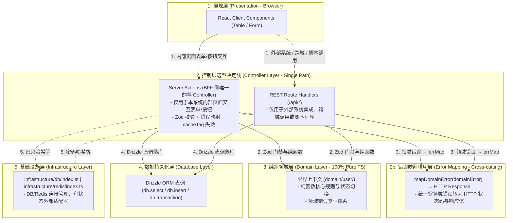

# Portal 架构设计与开发规范指南 (Zod门禁 + 领域纯函数 + Drizzle直调)

本指南旨在规范 `@auth-sso/portal` 项目在 Next.js 16 App Router + React 19 + Node.js 26 架构下的设计与重构标准。

> **版本演进说明**：本指南已针对 Next.js 16 的关键变化完成修订——包括 Cache Components（`use cache` 指令替代 `React.cache()`）、Middleware 更名为 Proxy、Server Functions 安全模型等。
>
> **最后更新 2026-10-23（文档校正）**：按现有代码逐条校正路径与行为。删除 `docs/brainstorms/portal-ddd-architecture-requirements.md` 引用（该目录已不在仓库，见 `docs/README.md:27`）；目录树、`packages/contracts` 文件、`lib/authz` 门面职责、`validate()` 签名、`src/proxy.ts` 实际代码、错误映射入口、测试文件路径按代码重写；删除与代码矛盾的「函数体 ≤ 25 行」「`db.query` 一律禁止」「`revalidatePath` + `revalidateTag` 双写」等规则（与 ADR-019 / 现有 `lib/cache-invalidation.ts` 冲突）。

---

## 一、 系统拓扑与单控制器技术选型边界 (Single Controller)

为了实现全栈同构架构下的**"极致轻量"**与**"单一真相源"**，我们明确禁止对同一个写操作同时编写两套控制器（如既写 Server Action 又写 REST API 路由）。控制层必须遵循以下技术选型矩阵进行单控制器决策：



### 核心分层职责：
1.  **读模型 (Read Model)**：Page 路由 (Server Component) 提取 URL `searchParams`，在数据拉取辅助器（`data.ts`）中直接通过 Drizzle SQL 获取扁平的数据对象，同步直传渲染，不经过 Domain 层包装，追求极致性能。
    *   **Next.js 16 缓存策略**：默认使用 `"use cache"` 指令 + `cacheLife()` 进行持久化缓存（跨请求复用），配合 `cacheTag()` 标签化失效。`React.cache()` 仅在未开启 `cacheComponents` 配置时作为降级方案（仅单次渲染周期去重）。
2.  **写模型 (Write Model - 单控制器原则)**：
    *   **判定标准**：如果一个写业务仅在我们自己内部的页面上调用，**一律只编写 Server Actions (actions.ts)**。严禁为其编写任何重复的 `/api/` 路由接口。
    *   **适用场景**：
        *   **Server Actions**：用于我们自己内部页面的表单提交、按钮点击、删除等操作，直接处理入参 Zod 解析，调用领域纯函数，直调 Drizzle 落库，并通过 `invalidateResource()`（`lib/cache-invalidation.ts`，内部同时失效页面路径与读模型标签）刷新缓存，返回 JS plain object 即可。
        *   **REST Route Handlers**：只有在发生**”外部系统集成（Webhook/OIDC 回调）”**、**”跨域/子系统用户开放 API 服务”**以及**”运维脚本与 cron 程序化调用”**这 3 种情况时，才允许为相应的写操作编写 API 路由。写后失效必须用 **route 版入口** `invalidateResourceFromRoute()` —— `invalidateResource()` 内部的 `updateTag` 在 Route Handler 里必抛（Next.js `E872`），抛出点在事务提交之后，会造成「写成功 + 失效未发生 + 5xx」。
    *   **统一规范**：控制层**不得包含任何业务逻辑判断**（唯一硬性约束），只做「编排 + 映射」；**不设行数上限**，复杂度由 lint 强制（`complexity ≤ 15`、`max-depth ≤ 4`，见 ADR-019）。
3.  **领域层 (Domain Layer)**：纯原生 TS 代码，零依赖 Next.js 模块。将所有核心业务规则（状态机转换、权限判定、数据计算与变换）抽象为**纯函数**（Plain Object 输入输出）。错误用**领域级错误类型**表达，由统一的**错误映射横切层**（`mapDomainError`）转换为 HTTP 响应。
4.  **数据持久化层 (Database Layer)**：不设置 Repository 接口与实现分离，不设 Mapper 转换层与工厂 DI。控制器层在通过 Zod 校验与领域函数处理后，直接调用 Drizzle 语句对数据库进行操作，直接引用由 Drizzle schema 推导出的物理类型，消除不必要的间接抽象层。涉及多表写入时必须在 Controller 层显式使用 `db.transaction()`。
5.  **基础设施层 (Infrastructure Layer)**：存放数据库连接、Redis 客户端、密码哈希等**有外部副作用的适配器**。`infrastructure/db/` 和 `infrastructure/redis/` 提供全局单例连接。区别于 `lib/`（纯业务工具与鉴权逻辑）。

---

## 二、 物理目录结构规范

重构与新建限界上下文 (Bounded Contexts) 时，应当严格按照以下路径划分职责，保持代码极致扁平，消除过度分层：

> 下面是与 `find apps/portal/src -type f` 实测结构一致的精简树（2026-10-23 校正）。只列**有职责约束**的位置；`components/ui/`（shadcn 原语）、`hooks/` 等不在此列。

```
src/
├── proxy.ts                          # Next.js 16 Proxy 层（源码根，不在 lib/ 下；职责见 §八）
│
├── app/                              # 1. 表现与应用层 (与 Next.js 强相关)
│   ├── (dashboard)/<route>/          #   - 内部管理页（Route Group：(dashboard)/layout.tsx 统一登录态 + 菜单）
│   │   ├── page.tsx                  #     路由直出入口 (Server Component 读模型)
│   │   ├── data.ts                   #     【读模型统一入口】所有 SELECT 查询集中于此（不含 'use server'）
│   │   │                             #     列表查询用 'use cache' + cacheLife + cacheTag，详情不缓存
│   │   ├── actions.ts                #     【写模型】仅 CUD Server Actions ('use server' + withAuth)
│   │   │                             #     禁止只读查询，禁止手写鉴权
│   │   ├── layout.tsx                #     只声明本路由权限码，守卫由 <PermissionGate> 统一装载
│   │   └── components/               #     客户端组件（表单、表格等）
│   ├── api/<resource>/route.ts       #   - REST API：GET 委托 data.ts，POST/PUT/DELETE 直调
│   ├── api/auth/oauth2/*/route.ts    #   - OAuth 2.1 端点（RFC 6749 格式，不套用本指南的响应封装）
│   └── audit/data.ts                 #   - 审计读模型（目录名无下划线，不在 (dashboard) 下）
│
├── domain/                           # 2. 纯净领域层 (零依赖 next/ / react/ / Drizzle)
│   ├── auth/                         #   - 登录、OAuth authorize/code、password、token-response、types
│   ├── client/  department/  permission/  role/  user/   # 各聚合根 BC：types.ts + <entity>.ts
│   └── shared/                       #   - 跨 BC 共享定义
│       ├── errors.ts                 #     * 领域级错误类型体系 (DomainError + 子类，携带 status)
│       ├── error-mapping.ts          #     * mapDomainError / mapToOAuthError（横切关注点）
│       ├── error-fields.ts           #     * 错误码 → 表单字段定位（客户端表单用）
│       ├── time.ts                   #     * Temporal.Instant ⇄ Date 转换（DB 边界唯一处）
│       ├── zod-schemas.ts            #     * Zod 枚举 / PasswordSchema / EmailSchema 集中导出
│       └── tree-utils.ts             #     * 泛型树构建工具
│
├── infrastructure/                   # 3. 基础设施层（有状态的连接/实例管理）
│   ├── db/index.ts                   #   - Drizzle + postgres-js 连接（全局单例；导出 db / schema / DbTxHandle）
│   └── redis/index.ts                #   - ioredis Redis 客户端（全局单例）
│
├── lib/                              # 4. 无状态共享工具与鉴权能力
│   ├── auth/                         #   - 鉴权模块（barrel + 子模块）
│   │   ├── index.ts                  #     * 统一 Barrel（推荐引入点：import {...} from '@/lib/auth'）
│   │   ├── guard.ts                  #     * withAuth / withPermission HOF + AuthContext
│   │   ├── verify-jwt.ts             #     * resolveIdentity（Gateway HMAC 信任路径 + 自验签兜底）
│   │   ├── check-permission.ts       #     * checkPermission / requirePermission（经 lib/permissions 查 Redis+DB）
│   │   ├── token.ts  token/          #     * JWT 签发与验签（verifyAccessToken）、signing-keys、revocation
│   │   └── oauth-*.ts  brute-force.ts  gateway-hmac.ts  client-credentials.ts …
│   ├── authz/                        #   - 数据范围授权门面（ADR-014，写/读/纯判定三类原语）
│   │   ├── index.ts                  #     * 唯一公开入口（scopeFilter / resolveScope / withScopedWrite / withScopedRow / withGlobalWrite）
│   │   ├── data-scope.ts             #     * resolveScope / isWithinScope / assertWithinScope（子树展开私有）
│   │   ├── write.ts                  #     * withScopedWrite（targets 非空）/ withScopedRow / withGlobalWrite（事务 + 快照 + 守卫）
│   │   └── query.ts                  #     * scopeFilter（空范围恒 FALSE）/ isScopeDenied
│   ├── session/                      #   - JWT/Session 模块（按职责拆分为子模块）
│   │   ├── index.ts                  #     * 统一 Barrel
│   │   ├── cookies.ts                #     * 只读：getJwtFromCookie / getRefreshTokenFromCookie
│   │   ├── jwt.ts                    #     * decodeJwtPayload（不验签；验签在 lib/auth/token.ts）
│   │   ├── revoke.ts                 #     * jti 黑名单紧急撤销 / 按用户撤销
│   │   └── auth-request-store.ts     #     * authorize 授权请求参数暂存（Redis）
│   ├── account/                      #   - 账号领域操作：change-password.ts / reset-password.ts
│   ├── cache-invalidation.ts         #   - 写后失效唯一真相源（invalidateResource / invalidateResourceFromRoute）
│   ├── response.ts                   #   - REST 工厂 restSuccess / restListSuccess / restError
│   ├── validation.ts                 #   - validate(schema, input) 校验门禁
│   ├── server-error.ts               #   - mapServerError（唯一服务端错误映射入口，含 23505 → 409）
│   ├── permissions.ts                #   - 权限上下文查询与 Redis 缓存（使用 infra 连接，不管理连接）
│   ├── audit.ts                      #   - 审计日志入库（使用 infra 连接，不管理连接）
│   ├── crypto.ts                     #   - 安全工具（ID/ClientId/Secret 生成）
│   ├── route-access.ts               #   - 「路径 → 功能权限」唯一出处（menu 与 layout 共用）
│   ├── menu-tree.ts                  #   - 动态菜单树
│   └── utils.ts                      #   - cn() CSS 类名合并
└── db/                               # 5. 物理存储定义（Schema + 查询模式）
    ├── schema/                       #   - schema barrel：index.ts / enums.ts / users / auth / rbac / org / logs / relations
    └── user-queries.ts               #   - 用户列表共享查询列选择 + 条件构建（schema 感知，不执行查询）
```

> **已不存在的位置（历史残留，勿照抄）**：`infrastructure/auth/auth-instance.ts`（Better Auth 已移除）、`lib/auth/data-scope.ts`（已收进 `lib/authz/`）、`lib/session/types.ts`（类型在 `domain/auth/types.ts`）、`lib/password.ts`（在 `domain/auth/password.ts`）、`db/schema.ts` / `db/types.ts`（已拆为 `db/schema/` 目录，行类型直接用 `$inferSelect`）。

### 2.1 类型单一真相源：消除 Zod / Drizzle / TS 三层重复

当前架构中，同一枚举（如 `UserStatus`）若在 `contracts`、`domain/shared/zod-schemas.ts`（Zod）、`db/schema/enums.ts`（Drizzle pgEnum）三处各自手写，修改一个字段就要同步多处，极易漂移。

**强制规范：枚举值数组是唯一真相源，Zod 和 Drizzle 均从同一数组派生。**

```
@auth-sso/contracts (零依赖纯 TS 包)          ← 唯一真相源
  └── index.ts: USER_STATUS_VALUES / ENTITY_STATUS_VALUES / PERMISSION_TYPE_VALUES …
  └── type UserStatus = typeof USER_STATUS_VALUES[number]        ← 自动推导，永不同步

domain/shared/zod-schemas.ts                  ← Zod 枚举集中处（所有 domain/*/types.ts 从此导入）
  └── import { USER_STATUS_VALUES } from '@auth-sso/contracts'
  └── z.enum(USER_STATUS_VALUES)              ← 从数组派生，不手写字面量

db/schema/enums.ts                            ← 物理存储
  └── import { USER_STATUS_VALUES } from '@auth-sso/contracts'
  └── pgEnum('user_status', USER_STATUS_VALUES) ← 同一数组

db/schema/index.ts（底部）                    ← 编译期类型守卫，见 §2.3
  └── UserRow extends Omit<User, 'deptName' | 'createdAt'> ? ✅ : ❌
```

**关键决策：废除 `UserPropsSchema`。** 该 Schema 既不用于输入校验（那是 `CreateUserInputSchema` 的职责），也不用于 DB 操作（那是 Drizzle `$inferSelect` 的职责），仅仅是字段名的第三次手写。Domain 层改用纯 `interface User`，由编译期类型守卫保证与 Drizzle schema 同步。

其他规范保持不变：
1. **直接引用 Drizzle 物理模型**：在表现层、读路径及数据操作中，直接使用 `typeof schema.users.$inferSelect` / `$inferInsert` 作为 DB 行类型，避免手写重复的 DTO 或 DB 行接口。
2. **Zod 入参门禁推导**：所有外部输入过 Zod Schema 校验，通过 `z.infer<typeof CreateUserInputSchema>` 自动生成类型，直接用作领域函数输入。
3. **消除 Branded Types**：ID、状态等均直接使用 `string` 类型。依靠清晰的变量命名（如 `userId`、`deptId`）在当前项目规模下保证安全，减少由 `.brand()` 引入的类型强转和摩擦成本。

### 2.2 API 响应类型契约

Portal 存在两种根本不同的调用协议，响应格式必须严格区分：

**Server Actions（RPC 风格，actions.ts）**：Server Action 是函数调用，不经过 HTTP 协议层，调用方无法从 HTTP 状态码判断成功/失败。因此必须用返回值中的 `success` 字段承载语义。

**REST HTTP 端点（route.ts）**：HTTP 协议自带状态码（200=成功，4xx/5xx=失败）。在响应体中额外包裹 `{ success: true/false }` 是协议层冗余反模式 — 数据应直接输出。

**OAuth2 端点（/api/auth/oauth2/*）**：遵循 RFC 6749/7662/7009 标准格式，不参与此规范。

```
                            ┌─────────────────────────────────┐
                            │  Server Actions (actions.ts)    │
                            │  → ApiResponse<T>               │
                            │  成功: { success: true, data }   │
                            │  失败: { success: false, error,  │
                            │          message }               │
                            └─────────────────────────────────┘

  POST /api/users ──────────┐
  GET  /api/me ─────────────┤
  POST /api/auth/login ─────┤
                             ▼
                            ┌─────────────────────────────────┐
                            │  REST HTTP 端点 (route.ts)      │
                            │  → HTTP 状态码 + 数据直出        │
                            │  成功: 200 + { data, pagination }│
                            │       或 200 + { user, token }   │
                            │  失败: 4xx/5xx + { error,        │
                            │          message }               │
                            └─────────────────────────────────┘

  /api/auth/oauth2/* ───────┐
                             ▼
                            ┌─────────────────────────────────┐
                            │  OAuth2 端点 (RFC 标准格式)       │
                            │  { access_token, token_type,     │
                            │    expires_in, refresh_token }   │
                            │  { error, error_description }    │
                            └─────────────────────────────────┘
```

**Server Action 响应格式**（定义在 `@auth-sso/contracts`）：

```typescript
// packages/contracts/src/index.ts

/** 仅适用于 Server Actions（RPC 调用，无 HTTP 状态码语义） */
type ApiSuccess<T> = {
  success: true;
  data: T;
  pagination?: { page: number; pageSize: number; total: number; totalPages: number };
  message?: string;
};

type ApiError = {
  success: false;
  error: ErrorCode;   // 闭合词汇表里的错误码（2026-10-15 由裸 string 收窄）
  message: string;
};

export type ApiResponse<T> = ApiSuccess<T> | ApiError;
```

**REST HTTP 响应格式**（`lib/response.ts` 提供工厂函数）：

```typescript
// lib/response.ts — REST 端点专用工厂

import { NextResponse } from 'next/server';

/** REST 成功 — 数据直出 */
export function restSuccess<T>(data: T, status?: number): NextResponse<T>

/** REST 列表成功 — 含分页 */
export function restListSuccess<T>(data: T[], pagination: PaginationMeta, status?: number):
  NextResponse<{ data: T[]; pagination: PaginationMeta }>

/** REST 错误 — { error, message }，无 success 字段。code 键入闭合词汇表 ErrorCode */
export function restError(code: ErrorCode, message: string, status: number):
  NextResponse<{ error: ErrorCode; message: string }>
```

> **Server Action 直接返回 plain object**：Server Actions 不使用工厂函数，直接返回 `{ success: true, data }` 或 `{ success: false, error, message }` 字面量。`withAuth` HOF 会捕获异常并交给 `mapServerError`（其内部委托 `mapDomainError`，并额外把 PG `23505` 翻译成 409）转换为标准错误格式。

**强制规则**：

| 端点类型 | 成功响应 | 错误响应 | 工厂函数 |
|---------|---------|---------|---------|
| REST 列表 GET | `{ data: T[], pagination: P }` | `{ error, message }` + 4xx/5xx | `restListSuccess` / `restError` |
| REST 详情 GET | 数据直出 | `{ error, message }` + 4xx/5xx | `restSuccess` / `restError` |
| REST 写操作 | `{ id, message }` 或空 `{}` | `{ error, message }` + 4xx/5xx | `restSuccess` / `restError` |
| Server Action | `{ success: true, data, message? }` | `{ success: false, error, message }` | 直接返回字面量，`withAuth` HOF 统一处理 |
| OAuth2 | RFC 6749 标准 | RFC 6749 标准 | 不使用工厂函数 |

> **为什么 REST 不用 `{ success: true }` 包裹？** HTTP 200 本身即成功语义。若仍需 `success` 字段确认，则语义上等价于不相信 HTTP 协议 — 这是反模式。Server Actions 作为 RPC 调用，没有 HTTP 协议层可借用，故 `success` 字段必要且正确。

### 2.3 编译期类型同步守卫（Domain ↔ Drizzle 不漂移）

Domain 层的 `interface User` 和 Drizzle 的 `$inferSelect` 是同一实体的两种表达，必须保持字段兼容。在 `db/schema/index.ts` 底部放置编译期守卫（**不是** `db/schema.ts`——该文件已不存在，schema 是目录）：

```typescript
// db/schema/index.ts (底部)
import type { User } from '@/domain/user/types';
import type { UserStatus } from '@auth-sso/contracts';

type UserRow = typeof users.$inferSelect;

// 守卫 1：Drizzle 行类型必须兼容 Domain 实体（新增 DB 列时此处报错 → 提示更新 interface User）
// createdAt 在 Domain 侧是 Temporal.Instant、deptName 是 JOIN 计算字段，两者都不是可比的物理列，故排除
type _UserRowCompatible = UserRow extends Omit<User, 'deptName' | 'createdAt'> ? true : never;

// 守卫 2：Drizzle 枚举值必须与 contracts 常值数组对齐（编译期穷举检查）
type _UserStatusInRow = UserRow['status'] extends UserStatus ? true : never;
type _UserStatusInDomain = UserStatus extends UserRow['status'] ? true : never;
```

> **原则**：新增/删除/重命名数据库列时，守卫语句会编译报错，强制开发者同步更新 `domain/` 中的 interface 和 `contracts` 中的常值。类型漂移在 CI 阶段即被拦截。

### 2.4 DB 行转换函数约定（消除 Controller 层重复列映射）

每个领域聚合根模块必须提供两个纯转换函数，集中管理「领域实体 → Drizzle 列」映射，消除 API Route 和 Server Action 中重复手写的列名对照：

```typescript
// domain/client/client.ts

/** 将领域实体转为 Drizzle insert 行（仅用于创建路径） */
export function clientToInsertRow(c: Client) {
  return {
    clientId: c.clientId,
    // ...
    createdAt: dateFromInstant(c.createdAt),   // Temporal.Instant → Date（domain/shared/time.ts）
  };
}

/** 将领域实体转为 Drizzle update 行（仅用于更新路径） */
export function clientToUpdateRow(c: Client) { /* 子集：不含 clientId/createdAt */ }

/** 反向：DB 行 → 领域实体（读路径） */
export function clientFromPersistence(client: Omit<Client, 'createdAt'> & { createdAt: Date }): Client
```

**强制规则**：
- Controller 层 `db.insert().values()` 必须调用 `xxxToInsertRow(entity)`，禁止手写列名映射
- Controller 层 `db.update().set()` 必须调用 `xxxToUpdateRow(entity)`，禁止手写列名映射
- 此函数属于领域层的「DB 适配」范畴：**时间转换只经 `domain/shared/time.ts`** 的 `dateFromInstant` / `instantFromDate`（不要在转换函数里写 `new Date()`；领域实体时间字段是 `Temporal.Instant`，见 §十一）
- 命名格式：`{entityCamelCase}ToInsertRow` / `{entityCamelCase}ToUpdateRow` / `{entityCamelCase}FromPersistence`

> **价值**：5 个聚合根（user/role/permission/department/client）各自的 Server Action 与 Route Handler 都经这三组函数落库，列名对照只有一处。

### 2.5 contracts 类型扩展约定（避免枚举值重复定义）

当 Portal 侧需要用比 `@auth-sso/contracts` 更丰富的类型时（如审计日志的登录事件类型比 contracts 的 `LoginEventType` 多了 `TOKEN_REFRESH`），**不得**在本地重新定义同名类型。应导入基础类型并以别名扩展：

```typescript
// lib/audit.ts  ✅ 正确做法
import { type LoginEventType as BaseLoginEventType } from '@auth-sso/contracts';

export type PortalLoginEventType =
  | BaseLoginEventType       // LOGIN_SUCCESS | LOGIN_FAILED | LOGOUT
  | 'TOKEN_REFRESH'
  | 'TOKEN_REFRESH_FAILED';
```

```typescript
// ❌ 错误做法：重复定义同名类型，与 contracts 脱钩
export type LoginEventType = 'LOGIN_SUCCESS' | 'LOGIN_FAILED' | ...;
```

---

## 三、 核心代码落地样例规范

### 3.1 第一步：`@auth-sso/contracts` 定义枚举常值（唯一真相源）

```typescript
// packages/contracts/src/index.ts —— 契约的唯一条目文件（没有 constants.ts）
export const USER_STATUS_VALUES = ['ACTIVE', 'DISABLED', 'LOCKED', 'DELETED'] as const;
export type UserStatus = typeof USER_STATUS_VALUES[number]; // 'ACTIVE' | 'DISABLED' | 'LOCKED' | 'DELETED'

export const ENTITY_STATUS_VALUES = ['ACTIVE', 'DISABLED'] as const;
export type EntityStatus = typeof ENTITY_STATUS_VALUES[number];
```

### 3.1b 第二步：领域层——纯 TS 接口 + Zod 入参门禁（不重复定义枚举值）

```typescript
// domain/user/types.ts
import { z } from 'zod';
import { type UserStatus } from '@auth-sso/contracts';
import { userStatusEnum, PasswordSchema, EmailSchema } from '@/domain/shared/zod-schemas';

// ── 领域实体（纯 TS interface，替代旧的 UserPropsSchema） ──
export interface User {
  id: string;
  username: string;
  email: string | null;
  name: string;
  status: UserStatus;
  deptId: string | null;
  avatarUrl: string | null;
  deletedAt: Temporal.Instant | null;      // 领域时间一律 Temporal.Instant（见 §十一）
  passwordChangedAt: Temporal.Instant | null;
  createdAt: Temporal.Instant;
}

// ── 入参门禁 Schema（仅外部输入，不包含内部字段如 id / createdAt） ──
// userStatusEnum / PasswordSchema / EmailSchema 均来自 domain/shared/zod-schemas.ts，
// 那里从 contracts 常值数组派生，不手写字面量。
export const CreateUserInputSchema = z.object({
  name: z.string().min(1, '姓名不能为空').max(100, '姓名最多 100 个字符'),
  username: z.string().min(3, '用户名至少3位').max(50, '用户名最多 50 个字符'),
  email: EmailSchema,
  password: PasswordSchema,
  deptId: z.string().nullable().optional(),
});
export type CreateUserInput = z.infer<typeof CreateUserInputSchema>;

export const UpdateUserInputSchema = z.object({
  id: z.string().min(1, '用户ID不能为空'),
  name: z.string().min(1, '姓名不能为空').max(100, '姓名最多 100 个字符').optional(),
  email: EmailSchema.optional(),
  status: userStatusEnum.optional(),            // ← 复用，非内联字面量
  deptId: z.string().nullable().optional(),
  avatarUrl: z.string().max(500, '头像地址最多 500 个字符').optional(),
});
export type UpdateUserInput = z.infer<typeof UpdateUserInputSchema>;
```

### 3.1c 第三步：Drizzle Schema 也从同一常值数组派生

```typescript
// db/schema/enums.ts（contracts 的常值是 as const readonly tuple，可直接传给 pgEnum）
import { USER_STATUS_VALUES, ENTITY_STATUS_VALUES } from '@auth-sso/contracts';

export const userStatusEnum = pgEnum('user_status', USER_STATUS_VALUES);
export const entityStatusEnum = pgEnum('entity_status', ENTITY_STATUS_VALUES);
```

> **强制规则**：任何枚举的合法值集合只在 `@auth-sso/contracts` 中定义一次。Zod 的 `z.enum()` 和 Drizzle 的 `pgEnum()` 均从 contracts 导出的常值数组派生，严禁在 domain/ 或 db/ 中手写枚举字面量。

### 3.2 领域层：错误类型体系 (domain/shared/errors.ts)

领域层使用**结构化错误类型**替代裸 `throw new Error()`，以便 Controller 精确映射 HTTP 状态码，且单元测试中易于断言：

```typescript
// domain/shared/errors.ts

/**
 * 领域错误基类 —— code 键入闭合词汇表 ErrorCode；status 由子类声明并**随实例走**
 * （不能按 constructor.name 反查：生产压缩会把类名压成单字母，曾导致 403 全部变 400）
 */
export class DomainError extends Error {
  constructor(
    public readonly code: ErrorCode,
    message: string,
    public readonly status: number = 400,
  ) {
    super(message);
    this.name = this.constructor.name;
  }
}

export class EntityNotFoundError extends DomainError {
  constructor(entity: string, id: string) {
    super(COMMON_ERRORS.NOT_FOUND, `${entity} [${id}] 不存在`, 404);
  }
}

export class BusinessRuleViolationError extends DomainError {
  constructor(rule: string, code: ErrorCode = COMMON_ERRORS.VALIDATION_ERROR) {
    super(code, rule, 422);
  }
}

export class DuplicateEntityError extends DomainError {
  constructor(entity: string, field: string, code: ErrorCode = COMMON_ERRORS.VALIDATION_ERROR) {
    super(code, `${entity} 的 ${field} 已存在`, 409);
  }
}

// 同文件还有：UnauthenticatedError(401) / ForbiddenError(403) / AccountStatusError(403)
// 以及 OAuth 侧 InvalidClientError / InvalidGrantError / PKCEVerificationError / InvalidRedirectUriError / InvalidScopeError
```

### 3.2b 错误映射横切层 (domain/shared/error-mapping.ts)

Controller 不手写 `if (err instanceof DuplicateEntityError)` 分支，而是通过统一的映射函数将领域错误转为 HTTP 响应。这是防腐的关键关口。**代码里只有一个分支**——所有子类各自携带 status，映射层不需要按类型逐个列举：

```typescript
// domain/shared/error-mapping.ts
import { DomainError } from './errors';
import { COMMON_ERRORS, AUTH_ERRORS, type ErrorCode } from '@auth-sso/contracts';

export function mapDomainError(err: unknown): ErrorMapping {
  if (err instanceof DomainError) {
    // 状态码随实例走（err.status），不按构造函数名反查
    return { status: err.status, error: err.code, message: err.message };
  }
  return { status: 500, error: COMMON_ERRORS.INTERNAL_ERROR, message: '服务器内部错误' };
}
// 同文件另有 mapToOAuthError(internalError) → RFC 6749 §5.2 错误码（token 端点用）
```

**服务端统一入口是 `lib/server-error.ts` 的 `mapServerError()`**（`withAuth` / `withPermission` 实际调用的就是它）：先 `unstable_rethrow` 保留 Next.js 控制流，再识别 PG 唯一约束违例（SQLSTATE `23505`）与数据形态错误（非法 UUID / 枚举文本 / 超长 / CHECK），最后回落到 `mapDomainError`。见 §3.4 的「唯一性冲突的机制在哪儿」。

### 3.3 领域层：聚合根纯函数 (domain/user/user.ts)

聚合根模块包含纯行为函数，输入输出为 Plain Object，不依赖任何数据库和外部框架，便于秒级单测：

```typescript
// domain/user/user.ts
import { USER_ACTIVE, USER_DISABLED, USER_LOCKED, USER_DELETED } from '@auth-sso/contracts';
import { type CreateUserInput, type User } from './types';
import { BusinessRuleViolationError } from '../shared/errors';

export type { User };

/**
 * 领域纯函数：构建新用户初始对象 (无副作用)
 */
export function createUser(
  input: CreateUserInput,
  idGenerator: () => string
): Omit<User, 'deletedAt' | 'passwordChangedAt'> & { deletedAt: null; passwordChangedAt: null } {
  return {
    id: idGenerator(),
    username: input.username,
    email: input.email,
    name: input.name,
    status: USER_ACTIVE,
    deptId: input.deptId || null,
    avatarUrl: null,
    deletedAt: null,
    passwordChangedAt: null,
    createdAt: Temporal.Now.instant(),
  };
}

/**
 * 领域纯函数：状态机切换规则 (无副作用)
 * DELETED / LOCKED 均不可直接切换——解锁必须走 unlockUser（对应 unlockUserAction）
 */
export function toggleUserStatus(user: User): User {
  if (user.status === USER_DELETED) {
    throw new BusinessRuleViolationError('已逻辑删除的用户无法操作状态');
  }
  if (user.status === USER_LOCKED) {
    throw new BusinessRuleViolationError('已锁定的用户无法直接切换状态，请使用解锁功能');
  }
  const newStatus: User['status'] = user.status === USER_ACTIVE ? USER_DISABLED : USER_ACTIVE;
  return { ...user, status: newStatus };
}

/**
 * 领域纯函数：逻辑删除用户 (无副作用)
 * 包含删除前置条件检查——Controller 不应自行判断能否删除
 */
export function deleteUser(user: User): User {
  if (user.status === USER_DELETED) {
    throw new BusinessRuleViolationError('用户已被删除，不可重复操作');
  }
  return { ...user, status: USER_DELETED, deletedAt: Temporal.Now.instant() };
}

/**
 * 领域纯函数：构建更新后的用户对象 (无副作用)
 * 将字段 merge 策略从 Controller 中下沉，消除 Controller 中的 `??` 链；
 * 同时承载状态机约束：请求 DELETED 走 deleteUser（写 deletedAt），LOCKED 不得经此切到其它状态
 */
export function applyUserUpdate(user: User, patch: Partial<Pick<User, 'name' | 'email' | 'status' | 'deptId' | 'avatarUrl'>>): User {
  if (user.status === USER_DELETED) {
    throw new BusinessRuleViolationError('无法更新已逻辑删除的用户');
  }
  /* 状态机判定省略，见 domain/user/user.ts 的 JSDoc（DC-USR-ST） */
  return {
    ...user,
    name: patch.name ?? user.name,
    email: patch.email ?? user.email,
    status: patch.status ?? user.status,
    deptId: patch.deptId !== undefined ? patch.deptId : user.deptId,
    avatarUrl: patch.avatarUrl ?? user.avatarUrl,
  };
}
```

### 3.4 表现层：薄 Controller 规范 (actions.ts / route.ts)

表现层直接执行 **Zod 校验门禁 -> 调用领域纯函数判断 -> Drizzle 数据库直调**。函数体内**不得出现业务逻辑判断**（唯一硬性约束）；**不设行数上限**，复杂度由 lint 强制（见 ADR-019）。错误**不在 Controller 里映射**——`withAuth` / `withPermission` 已把异常交给 `mapServerError`。

真实签名（`apps/portal/src/lib/validation.ts`、`lib/auth/guard.ts`）：

```typescript
// lib/validation.ts —— 返回判别式联合，不是 throw
export function validate<T>(schema: z.ZodSchema<T>, input: unknown): { ok: true; data: T } | { ok: false; response: ApiError }

// lib/auth/guard.ts
export interface AuthContext { userId: string }

export function withAuth<TArgs extends unknown[], TData>(
  options: PermissionCheckOptions,
  fn: (ctx: AuthContext, ...args: TArgs) => Promise<ApiResponse<TData>>
): (...args: TArgs) => Promise<ApiResponse<TData>>
```

```typescript
// app/(dashboard)/users/actions.ts (Server Actions Controller)
'use server';

import { withAuth, type AuthContext } from '@/lib/auth';
import { invalidateResource } from '@/lib/cache-invalidation';
import { validate } from '@/lib/validation';
import { createUser, userToInsertRow } from '@/domain/user/user';
import { CreateUserInputSchema, type CreateUserInput } from '@/domain/user/types';
import { generateUUID } from '@/lib/crypto';
import { hashPassword } from '@/domain/auth/password';
import { withScopedWrite } from '@/lib/authz';
import { USER_PERMISSIONS } from '@auth-sso/contracts';
import type { ApiResponse } from '@auth-sso/contracts';

export const createUserAction = withAuth(
  { permissions: [USER_PERMISSIONS.CREATE], audit: 'USER_CREATE' },
  async (
    ctx: AuthContext,
    firstArg: CreateUserInput | null | undefined,
    secondArg?: FormData,
  ): Promise<ApiResponse<{ id: string }>> => {
    const rawInput = secondArg !== undefined ? Object.fromEntries(secondArg) : firstArg;
    const v = validate(CreateUserInputSchema, rawInput);   // ← 门禁；失败直接返回 v.response
    if (!v.ok) return v.response;

    const passwordHash = await hashPassword(v.data.password);   // bcrypt 在事务外（不占 DB 连接）

    // 范围守卫 + 查重 + 插入同一事务（ADR-014）；handler 只拿得到 tx
    const result = await withScopedWrite(
      {
        operatorId: ctx.userId,
        targets: v.data.deptId ? [{ deptId: v.data.deptId, message: '无权在指定部门下创建用户' }] : [],
        preflight: async (tx) => { if (v.data.deptId) await assertDepartmentUsable(tx, v.data.deptId, '在该部门下创建用户'); },
      },
      async (tx) => {
        /* 查重 → createUser → tx.insert(schema.users).values({ ...userToInsertRow(user), passwordHash }) */
      },
    );

    invalidateResource('users');                        // 路径 + 标签唯一真相源（SSR 位置用这个）
    return { success: true, data: { id: result.id }, message: '用户创建成功' };
  });
```

> **唯一性冲突的机制在哪儿？（2026-10-13 补，架构评审 R2 候选 R10）**
>
> 上面的"**先查后写**"只是**更早给出消息**的优化，**不是正确性依赖**——它对并发不安全：
> 两个并发请求都能通过 `existing.length === 0`，落库时后者仍会撞约束。
>
> 真正的保证在**服务端边界**：`lib/server-error.ts` 的 `mapServerError()` 沿 `cause` 链
> 识别 PostgreSQL 唯一约束违例（SQLSTATE `23505`，Drizzle 会把它包在
> `DrizzleQueryError.cause` 里）并翻译成 `DuplicateEntityError` → **409**。
> 因此：
>
> - 实体是否需要 `DuplicateEntityError` 预检查**不影响状态码正确性**（边界兜底）；
> - **任何**未被预检查覆盖的唯一约束（含 update 路径改字段）都自动得到 409，
>   而不是 500「服务器内部错误」；
> - 消息由 `table_name` + `detail` 的**列名**翻译而来，**绝不回显冲突值**
>   （`detail` 里带的是库里已存在那位的邮箱/手机号/用户名）。
>
> 新加唯一约束时**无需**额外做预检查；`lib/db-errors.test.ts` 与
> `__tests__/api/db-unique-violation.test.ts` 已覆盖六条用户可触发的约束。

### 3.5 表现层：REST Route Handler 薄 Controller 示例 (route.ts)

```typescript
// app/api/users/route.ts (REST API Route Handler)
import { NextRequest } from 'next/server';
import { withPermission } from '@/lib/auth';
import { validate } from '@/lib/validation';
import { restSuccess, restError } from '@/lib/response';
import { withScopedWrite } from '@/lib/authz';
import { USER_PERMISSIONS } from '@auth-sso/contracts';

export async function POST(req: NextRequest) {
  // withPermission 的 handler 形参是 userId（string），返回 NextResponse
  return withPermission({ permissions: [USER_PERMISSIONS.CREATE] }, async (userId) => {
    const v = validate(CreateUserInputSchema, await req.json());
    if (!v.ok) return restError(...) /* 见 restError 签名 */;

    const user = await withScopedWrite({ operatorId: userId, targets: [...] }, async (tx) => {
      /* 查重 → createUser → tx.insert(...).values({ ...userToInsertRow(user), passwordHash }) */
    });

    // REST 端点：数据直出，HTTP 201 即成功语义，无 { success: true } 包裹
    return restSuccess({ id: user.id }, 201);
  });
}
```

> 异常（含 `ForbiddenError` / `EntityNotFoundError` / PG 违例）由 `withPermission` 的 catch 交给 `mapServerError` → `restError`，**handler 里不写 try/catch，也不写 `instanceof` 分支**。

### 3.6 读路径：`use cache` 持久化缓存（Next.js 16 推荐）

Next.js 16 启用 `cacheComponents: true` 后，使用 `"use cache"` 指令替代 `React.cache()`：
- `React.cache()` 仅在单次渲染周期内去重（请求级别），不跨请求复用
- `"use cache"` 持久化缓存跨请求复用，配合 `cacheLife()` / `cacheTag()` 精细控制

```typescript
// app/(dashboard)/users/data.ts —— 真实签名：scope 是**入参**，鉴权在缓存作用域外完成
import 'server-only';
import { cacheLife, cacheTag } from 'next/cache';
import { eq, and } from 'drizzle-orm';
import { db, schema } from '@/infrastructure/db';
import { USER_LIST_COLUMNS, buildUserListConditions } from '@/db/user-queries';
import { isScopeDenied } from '@/lib/authz';
import type { UserScope } from '@/lib/authz';

export async function getUsers(
  scope: UserScope,
  userId: string,
  params: { page: number; pageSize: number; keyword: string; status: string; deptId?: string },
) {
  'use cache';
  cacheLife('minutes');          // 缓存生命周期：分钟级
  cacheTag('users-list');        // 标签化，写后由 invalidateResource('users')/invalidateResourceFromRoute('users') 失效

  if (isScopeDenied(scope)) return { data: [], pagination: paginationMeta(page, pageSize, 0) };

  const conditions = buildUserListConditions({ keyword, status, scope, userId });
  if (params.deptId) conditions.push(eq(schema.users.deptId, params.deptId));
  // ... db.select(USER_LIST_COLUMNS).from(schema.users).leftJoin(...).where(and(...conditions))
}
```

> **`'use cache'` 的两条硬约束（代码里已在执行）**：
> 1. **鉴权必须在缓存作用域外**——`resolveScope()` 读 DB/Redis，`scope` 只能作为**参数**传入（`users/data.ts` 的注释即此规则）；
> 2. 详情查询**不加缓存**（`getUser` / `getOwnUser` 无 `'use cache'`），保证实时性。
>
> **降级方案**：若未开启 `cacheComponents`，继续使用 `React.cache()` 作为请求级去重。但强烈建议迁移至 Cache Components 以获得更好的性能与更清晰的失效语义。

---

## 四、 单元测试与 TDD

只在不依赖任何框架的 `domain/` 下高频推行 TDD：

```typescript
// apps/portal/__tests__/domain/user.test.ts —— 单元测试在 __tests__/{domain,components,api}
import { describe, it, expect } from 'vitest';
import { toggleUserStatus, createUser } from '@/domain/user/user';
import { BusinessRuleViolationError } from '@/domain/shared/errors';

describe('User 领域核心规则 TDD 测试', () => {
  it('应通过工厂函数创建初始状态为 ACTIVE 的用户', () => {
    const input = { name: '测试', username: 'test', email: 'a@a.com', password: 'Passw0rd!2026' };
    const user = createUser(input, () => 'generated_id');
    expect(user.status).toBe('ACTIVE');
  });

  it('当激活态用户切换状态时，应变为禁用状态', () => {
    const user = {
      id: 'u_1', username: 'test', email: 'a@a.com', name: '测试',
      status: 'ACTIVE' as const, deptId: null, avatarUrl: null,
      deletedAt: null, passwordChangedAt: null, createdAt: Temporal.Now.instant(),
    };
    expect(toggleUserStatus(user).status).toBe('DISABLED');
  });

  it('当删除态用户切换状态时，应抛出 BusinessRuleViolationError', () => {
    const user = { /* 同上，status: 'DELETED' as const */ };
    expect(() => toggleUserStatus(user)).toThrow(BusinessRuleViolationError);
  });
});
```

> 测试分层与命令（`pnpm test:components` / `test:api` / `test:e2e`）、`@req` 追溯与模块 mock 纪律的唯一出处是 `AGENTS.md`「测试体系」一节。

---

## 五、 架构边界自动化守护（规划中）

> **当前状态（2026-10-23 核实）**：`eslint-plugin-boundaries` **未安装**（不在 `package.json`），`eslint.base.mjs` 与 `apps/portal/eslint.config.mjs` 里也**没有** `boundaries` 配置。以下为设计目标，实际通过 Code Review 人工守护层间依赖方向。如业务代码膨胀后频繁出现层间违规，应优先启用此自动化门禁。
>
> 当前**真正生效**的 lint 门禁是 `eslint.base.mjs` 的三条：`complexity: ["warn", 15]`、`max-depth: ["warn", 4]`、`max-lines-per-function: ["warn", 150]`（后两条见 ADR-019；测试目录 `max-lines-per-function` 被置 `off`）。

使用 `eslint-plugin-boundaries` 强制层间依赖方向，将架构约束作为 **CI 级硬拦截**：

```javascript
// eslint.config.mjs (architecture boundary rules — 待启用)
import boundaries from 'eslint-plugin-boundaries';

export default [
  {
    plugins: { boundaries },
    settings: {
      'boundaries/elements': [
        { type: 'domain',          pattern: ['src/domain/*'] },
        { type: 'app',             pattern: ['src/app/*'] },
        { type: 'lib',             pattern: ['src/lib/*'] },
        { type: 'infrastructure',  pattern: ['src/infrastructure/*'] },
      ]
    },
    rules: {
      'boundaries/element-types': [2, {
        default: 'disallow',
        rules: [
          { from: 'domain', allow: ['domain'] },
          { from: 'infrastructure', allow: ['infrastructure', 'lib', 'domain'] },
          { from: 'lib', allow: ['lib', 'domain', 'infrastructure'] },
          { from: 'app', allow: ['domain', 'lib', 'infrastructure', 'app'] },
        ]
      }],
    }
  }
];
```

### 导入允许矩阵

| 源层 → 目标层 | domain | lib | infrastructure | app |
| :--- | :---: | :---: | :---: | :---: |
| **domain** | ✅ | ❌ | ❌ | ❌ |
| **lib** | ✅ | ✅ | ✅ | ❌ |
| **infrastructure** | ✅ | ✅ | ✅ | ❌ |
| **app** | ✅ | ✅ | ✅ | ✅ |

---

## 六、 命名与物理边界约束表

| 文件类别 | 物理命名格式 | 允许导入的依赖 | 职责限制 | 自动化守护 |
| :--- | :--- | :--- | :--- | :--- |
| **首屏拉取** | `page.tsx` | 展示子组件, `data.ts` | 读模型入口，严禁写操作 | — |
| **数据直调** | `data.ts` | `drizzle-orm`, `next/cache` (`cacheLife`/`cacheTag`), `@/lib/authz` | Drizzle 数据直接查询，使用 `"use cache"` 持久化缓存，绕过领域层直取只读数据。**鉴权在缓存作用域外完成，`scope` 作为参数传入**；详情查询可走 `db.query.*.findFirst`（见 §七 red flag 14） | — |
| **Client Component 表单** | `components/*.tsx` | `react-dom`, Server Actions | 必须使用 `useFormStatus` 或 `useActionState` 防止重复提交 | — |
| **Server Action** | `actions.ts` | `next/cache`（经 `lib/cache-invalidation`）, `domain/`, `lib/auth` (`withAuth`), `lib/authz`, `lib/validation`, `infrastructure/db` | **不得含业务逻辑判断**，只做「编排 + 映射」（见 ADR-019）。`validate(schema, input)` 校验入参，`xxxToInsertRow()` 统一 DB 映射，Drizzle 直调 + 事务 | `complexity`(15) / `max-depth`(4) |
| **API 路由** | `route.ts` | `next/server`, `domain/`, `lib/auth` (`withPermission`), `lib/authz`, `lib/response`, `infrastructure/db` | REST 写网关，约束同上（不得含业务逻辑判断）。使用 `withPermission()` 包装 | `complexity`(15) / `max-depth`(4) |
| **领域操作（编排）** | `lib/<area>/<operation>.ts` | `domain/`, `infrastructure/db`, 其他 `lib/*` | 一个具名业务操作的步骤编排（bcrypt/DB/会话撤销/外部副作用）。**Controller 变薄的正确途径是给操作起名字**，而不是削行数（ADR-019）。现有实例：`lib/account/{change-password,reset-password}.ts` | — |
| **数据范围门面** | `lib/authz/{index,data-scope,write,query}.ts` | `infrastructure/db`, `drizzle-orm`, `domain/shared/errors` | 范围快照与使用必须绑定同一执行器（ADR-014 / ADR-028）：写路径用 `withScopedWrite`（targets 非空）/ `withScopedRow`（先加载行）/ `withGlobalWrite`（根部门等全局资源），读路径只用 `scopeFilter` / `isScopeDenied`，纯判定用 `isWithinScope` / `assertWithinScope`。**不导出** `getUserRoleDeptIds` / `canAccessDept` | — |
| **领域层核心** | `domain/*/*.ts` | **仅限 `@auth-sso/contracts` + `zod` + `bcryptjs` + `jose`（类型）+ `node:crypto`** | 纯函数计算 + `xxxToInsertRow`/`xxxToUpdateRow`/`xxxFromPersistence` DB 行转换。枚举值必须从 contracts 导入 | 人工（boundaries 未启用） |
| **领域实体接口** | `domain/*/types.ts` | 纯 TS `interface`，`zod` | 替代旧 `UserPropsSchema`。Interface 不绑 Zod，仅描述实体结构。与 Drizzle `$inferSelect` 的兼容性由编译期守卫保证（`db/schema/index.ts` 底部） | — |
| **领域错误** | `domain/shared/errors.ts` | 仅限纯 TypeScript + contracts 的错误码 | DomainError 基类及子类（各自携带 status） | 人工 |
| **错误映射** | `domain/shared/error-mapping.ts` | `domain/shared/errors.ts`，`@auth-sso/contracts` | `mapDomainError` / `mapToOAuthError`。服务端统一入口是 `lib/server-error.ts` 的 `mapServerError`（含 PG 23505 → 409） | 人工 |
| **Zod Schema 共享** | `domain/shared/zod-schemas.ts` | `@auth-sso/contracts`, `zod` | 所有 Zod 枚举 Schema 集中导出。domain/*/types.ts 从此文件导入，禁止在各 domain 中手写 `z.enum()` | — |
| **时间边界** | `domain/shared/time.ts` | 仅限纯 TypeScript | `dateFromInstant` / `instantFromDate`：领域用 `Temporal.Instant`，只在 DB 边界转 `Date` | — |
| **泛型树工具** | `domain/shared/tree-utils.ts` | 仅限纯 TypeScript | `buildTree<T>()` 泛型树构建函数（`lib/menu-tree.ts` 等委托至此） | — |
| **权限上下文** | `lib/permissions.ts` | `infrastructure/db`, `infrastructure/redis` | 用户权限上下文获取与缓存（无状态——使用 infra 提供的连接，不管理连接生命周期） | — |
| **审计日志** | `lib/audit.ts` | `infrastructure/db` | 审计日志入库与高阶装饰器（无状态——使用 infra 提供的连接） | — |
| **密码工具** | `domain/auth/password.ts` | `bcryptjs` | 密码哈希/验证/历史比对（领域层纯函数） | — |
| **响应工厂** | `lib/response.ts` | `next/server` | REST 端点用 `restSuccess`/`restListSuccess`/`restError`（NextResponse）。Server Action 直接返回字面量，`withAuth` HOF 统一处理异常映射。 | — |
| **缓存失效** | `lib/cache-invalidation.ts` | `next/cache` (`revalidatePath`/`revalidateTag`/`updateTag`) | 资源 → 路径与标签的**唯一真相源**；按写入位置选 `invalidateResource`（Action）/ `invalidateResourceFromRoute`（Route） | `__tests__/api/cache-invalidation-site-guard.test.ts` |
| **基础设施** | `infrastructure/*/index.ts` | `lib/`, `domain/`, 第三方 SDK | **有状态**的外部适配器（DB 连接、Redis 客户端）。区别于 lib/：这些模块管理连接/实例生命周期 | 人工 |
| **Auth 鉴权** | `lib/auth/*.ts` | `lib/permissions`, `lib/session`, `lib/authz`, `infrastructure/db` | 鉴权子模块。权限/角色检查使用 lib/ 中的工具和 infra 中的连接。推荐统一从 `@/lib/auth` 导入 | — |
| **Session/JWT** | `lib/session/*.ts` | `jose`, `infrastructure/redis` | JWT Cookie **只读**、快速解码、jti 撤销、授权请求暂存。**验签在 `lib/auth/token.ts`**。推荐统一从 `@/lib/session` 导入 | — |

---

## 七、 关键约束红线 (Code Review 一票否决)

以下违规在 Code Review 中**一票否决**，不得合入主干：

1. **领域层 import `next/*` 或任何外部框架依赖** —— 破坏零框架依赖原则（允许清单见 §六「领域层核心」行）。
2. **Controller/Action 中包含核心业务规则判断（如状态机逻辑、字段 merge 策略、`??` 链式默认值赋值）** —— 职责越界，必须下沉为纯函数。
3. ~~**Controller/Action 函数体超过 25 行**~~ —— **已废除**（与 ADR-019 冲突：ADR-019 明确「不设行数上限」，长度不是复杂度的好代理）。现行门禁是 `complexity ≤ 15`、`max-depth ≤ 4`，见 `eslint.base.mjs`。
4. **Server Action 入参手动 `if (!field)` 判空而非 Zod 校验** —— 遗漏字段校验路径，必须使用 `validate()` 作为唯一门禁。
5. **领域层抛出 `throw new Error(...)` 而非领域错误类型** —— 丢失结构化错误语义。
6. **Controller 层手写 `if (err instanceof XxxError)`** —— 错误由 `withAuth` / `withPermission` 统一交给 `mapServerError`（其内部委托 `mapDomainError`），Controller 不写映射分支。
7. **涉及多表写入的 Controller 未使用 `db.transaction()` 包裹** —— 数据一致性风险。写路径**优先用 `withScopedWrite`（targets 非空）/ `withScopedRow`，全局资源写用 `withGlobalWrite`**（它们内部已开事务并绑定范围快照，见 §八 8.4）。
8. **读路径中重复编写部门范围过滤分支（手写 `inArray(users.deptId, deptIds)` / 空范围 `sql\`FALSE\`` 判定）** —— 必须复用 `lib/authz` 的 `scopeFilter()` / `isScopeDenied()`。
9. **`domain/` 或 `db/` 中手写枚举字面量（`z.enum(['ACTIVE',...])` / `pgEnum('...', ['ACTIVE',...])`）** —— 枚举值必须从 `@auth-sso/contracts` 常值数组派生，单一真相源。
10. **`domain/` 中保留 `XxxPropsSchema`（如 `UserPropsSchema`）** —— 已废除。Domain 实体用纯 `interface`，不再用 Zod Schema 描述实体全貌。
11. **API Route GET 处理器中出现直接 `db.select()` / `db.query` DB 调用** —— 读操作必须委托给 `data.ts` 统一读模型，Route 只做鉴权 + 委托。
12. **`actions.ts` 中存在只读查询函数（如 `getXxxAction`）** —— `actions.ts` 仅保留 CUD 写操作，读归 `data.ts`。
13. ~~**写操作只调 `revalidatePath` 未调 `revalidateTag`，必须 `revalidatePath` + `revalidateTag` 双写**~~ —— **改写为**：**写后失效必须经 `lib/cache-invalidation.ts`**，按写入位置选入口（Action → `invalidateResource`，Route → `invalidateResourceFromRoute`）；**不得**在调用点手写 `revalidatePath` / `revalidateTag` / `updateTag`——资源表与跨资源标签（如 `departments` 供用户表单下拉）散落在调用点必漏。
14. ~~**`data.ts` 函数使用 `db.query.xxx.findFirst()`**~~ —— **已废除**。两类风格并存且各有明确适用场景：列表/聚合查询用 `db.select().from().where()`；关系加载（用户 + 角色 + 部门）用 `db.query.*.findFirst({ with: … })`（`users/data.ts`、`roles/data.ts`、`oauth2/authorize/data.ts` 均为后者）。
15. **REST route.ts 响应体中出现 `success: true` / `success: false`** —— REST HTTP 状态码即成功/失败语义，`{ success, data }` 包裹是协议层冗余反模式。Server Actions 的 `ApiResponse<T>` 格式仅适用于 RPC 调用。
16. **Route Handler 里调用 `invalidateResource()`（内部 `updateTag`）** —— `updateTag` 在 route 上下文必抛 Next.js `E872`，抛出点在事务提交之后 ⇒ 写成功 + 响应 5xx。改用 `invalidateResourceFromRoute()`（`revalidateTag(tag, { expire: 0 })`）。机械守卫：`__tests__/api/cache-invalidation-site-guard.test.ts`。
17. **`withScopedWrite` / `withScopedRow` 的空 handler**（如 `async () => undefined`）—— 看着加了守卫，实为零写入（断言在一个事务里、真正的写入落在另一个事务，快照与写入不再同事务）。需要先加载目标行时用 `withScopedRow`，并让 handler 真正使用 `tx` / `row`。**空 targets 同样不可**：`targets: []` 在类型与运行时都被拒绝（ADR-028）；全局资源写用 `withGlobalWrite`。机械守卫：`__tests__/api/scoped-write-guard.test.ts`。

---

## 八、 Server Action / Server Function 安全基线

以下为 Server Action 与 API 路由的安全底线要求，所有写操作必须满足。采用 **Gateway 验签 + Proxy CSRF + Action 精细鉴权** 的三层防御模型：

```
┌──────────────────────────────────────────────────────────────────┐
│ 第一层：Gateway (Rust/Pingora 边缘网关)                            │
│ • ES256 JWKS 离线 JWT 验签（签名 + 过期 + issuer）                 │
│ • 按 PathClass 重写上行 Cookie 并注入 Authorization: Bearer        │
│ • 拒绝无有效 JWT 的请求（401）                                     │
│ ⚠ 不查 DB/Redis，不做权限编码校验                                  │
│ ⚠ 不查 JWT claims 中的 permissions（时效性问题，见下文）            │
└──────────────────────────┬───────────────────────────────────────┘
                           ▼
┌──────────────────────────────────────────────────────────────────┐
│ 第二层：Proxy (src/proxy.ts，超集校验)                              │
│ • 同源校验（POST/PUT/PATCH/DELETE 带 Origin 时比对，跨站 → 403）      │
│ • JWT Cookie 存在性检查；无值 → 302 /login                          │
│ • 白名单直通：/login、/oauth/error、/.well-known、/api/*、/_next 等   │
│ ⚠ 不做验签、不做权限判定                                             │
└──────────────────────────┬───────────────────────────────────────┘
                           ▼
┌──────────────────────────────────────────────────────────────────┐
│ 第三层：withAuth Guard (Portal 应用精细鉴权)                        │
│ • resolveIdentity（Gateway HMAC 信任路径 / 自验签兜底）              │
│ • 细粒度权限编码校验——实时查询 DB + Redis 缓存（lib/permissions）      │
│ • 数据范围/资源所有权校验（lib/authz 门面，含子树展开）                │
│ • 统一错误映射 mapServerError（内部委托 mapDomainError）              │
│ ✅ 运行在 Node.js Runtime，完整访问 Drizzle/DB/Redis               │
└──────────────────────────────────────────────────────────────────┘
```

### 为什么 Gateway 不做权限编码校验？

Gateway 已经解码了 JWT，JWT claims 中也确实包含 `permissions` 和 `roles`。**技术上可行，但安全上不可靠**：

| 方式 | 权限生效延迟 | 数据范围 | jti 撤销 |
|------|-------------|---------|---------|
| Gateway 读 JWT claims 做权限检查 | **最长 Token 有效期**（换发才刷新） | ❌ 无法做（需子树展开） | ❌ 无 Redis |
| Portal Action 查 DB 做权限检查 | **最长约 1h**（Redis 缓存 TTL 3600s ± 300s 抖动，`lib/permissions.ts` 的 `PERM_CACHE_TTL_BASE`/`PERM_CACHE_TTL_JITTER`） | ✅ `lib/authz` 的 `resolveScope` / `withScopedWrite` | ✅ `isJtiRevoked()`（`lib/session/revoke.ts`） |

管理后台的权限变更（如管理员撤销某用户的删除权限）需要尽快生效。依赖 JWT claims 意味着攻击窗口 = Token 剩余有效期。因此，**权限检查必须在 Portal Action 层实时查 DB / 缓存**，Gateway 仅负责"这个请求带了一个有效 JWT 吗"的身份校验。

> **例外**：如果系统接受 Token 有效期的权限变更延迟，可以将 Gateway 的 Claims struct 扩展为包含 `permissions` 字段做粗粒度角色门禁（如"非 admin 角色拒绝访问 /api/admin/*"）。这是一种性能优化（减少抵达 Portal 的无效请求），**但不能替代** Action 层的精细鉴权。

### 8.1 第一层：Gateway（Rust/Pingora，离线 JWT 验签 + Cookie→Bearer 转换）

Gateway 是系统的**最外层安全边界**，运行在 Rust/Pingora 上，性能极高。它不访问 DB/Redis，只做纯 CPU 的 JWT 离线验签：

```
请求进入 → Gateway 提取 Cookie 中的 portal_jwt_token
         → 从内存 JWKS 缓存取 ES256 公钥（每 5min 自动刷新）
         → 本地验签（签名 + 过期 + issuer）
         → 通过：按路径分类重写 Cookie（Protected 剥 RT/换 AT、Microservice 清全部），
           注入 Authorization: Bearer <JWT> 与 X-User-Id / X-User-Jti，转发给 Portal
         → 失败：直接返回 401
```

Gateway 代码位于 `apps/gateway/src/gateway.rs`（ProxyHttp 五阶段，Cookie 重写见 `rewrite_upstream_cookies`），进程入口在 `apps/gateway/src/main.rs`。**不在此处扩展权限检查**的原因见上文时效性分析。

### 8.2 第二层：Proxy（同源校验 + JWT 存在性）

真实实现见 `apps/portal/src/proxy.ts`（108 行）：`isCrossSiteWrite()` 先做同源校验，再按白名单放行，最后检查 JWT Cookie：

```typescript
// apps/portal/src/proxy.ts（节选，签名与顺序与代码一致）
const PUBLIC_PATHS = ['/login', '/oauth/error', '/.well-known'];
const SKIP_PREFIXES = ['/_next', '/favicon', '/images', '/fonts'];

export async function proxy(request: NextRequest) {
  if (isCrossSiteWrite(request)) return new NextResponse('Forbidden', { status: 403 });  // ① 同源校验先行
  const { pathname } = request.nextUrl;
  if (isPublicPath(pathname) || isSkipPath(pathname) || pathname.startsWith('/api/')) {
    return NextResponse.next();                                                          // ② 白名单直通
  }
  const jwtToken = request.cookies.get(COOKIE_NAMES.JWT);
  if (!jwtToken?.value) return NextResponse.redirect(new URL('/login', request.url));    // ③ 无 JWT → /login
  return NextResponse.next();
}

export const config = { matcher: ['/((?!_next|favicon\\.ico|images|fonts).*)'] };
```

> **注意**：本地开发环境（无 Gateway）时，Portal 自身通过 `resolveIdentity()`（`lib/auth/verify-jwt.ts`）完成身份验证——优先信任 Gateway 注入且通过 HMAC 校验的 `X-User-Id`，否则回退到 `verifyAccessToken`（`lib/auth/token.ts`）自验签。JWT 签发使用 DB 存储的 ES256 密钥对。Proxy **不做验签**——那是 Portal Action 层的职责。

### 8.3 第三层：withAuth Guard 精细鉴权

Server Action 层通过 `withAuth` 高阶函数统一施加鉴权，确保无法绕过：

```typescript
// lib/auth/guard.ts（真实实现）
export interface AuthContext { userId: string }

export function withAuth<TArgs extends unknown[], TData>(
  options: PermissionCheckOptions,
  fn: (ctx: AuthContext, ...args: TArgs) => Promise<ApiResponse<TData>>
): (...args: TArgs) => Promise<ApiResponse<TData>> {
  return async (...args: TArgs): Promise<ApiResponse<TData>> => {
    try {
      const check = await checkPermission(options);      // 无需传 headers：内部 resolveIdentity()
      if (!check.authorized) throw check.reason;         // 失败**抛出** DomainError ⇒ 与业务错误同一 catch
      const res = await fn({ userId: check.userId }, ...args);
      if (res.success && options.audit) await recordActionAudit(check.userId, options.audit);
      return res;
    } catch (err: unknown) {
      const mapped = mapServerError(err);                // 唯一服务端错误映射入口
      return { success: false, error: mapped.error, message: mapped.message };
    }
  };
}
```

`PermissionCheckOptions`（`lib/auth/check-permission.ts`）：`permissions?` / `roles?` / `requireAll?` / `audit?`。管理员角色绕过**权限码**检查，但**不绕过** `roles` 检查。

### 8.4 其他安全措施

1. **Server Function 公开可达性警告**：Next.js 16 的 Server Function 可通过直接 HTTP POST 请求调用，**不仅仅通过你的 UI**。这正是三层防御存在的理由——Gateway 拒绝无有效 JWT 的请求，Proxy 拦截跨站写，`withAuth` 拦截无权限的合法登录用户。

2. **请求体大小限制**：`serverActions.bodySizeLimit` 当前**未配置**（`apps/portal/next.config.ts`、根 `next.base.ts` 均无该字段，走 Next.js 默认值）。如需收紧，在 `next.config.ts` 的 `experimental.serverActions.bodySizeLimit` 配置；**文档不把它当作既有事实**。

3. **Session Cookie 安全策略**：Session Cookie 必须设置 `SameSite=Lax`（默认值），防止 CSRF 跨站提交。严禁降级为 `SameSite=None`（除非有明确的跨域 SSO 场景并配合 `Secure` 标志）。

4. **资源所有权校验（数据范围过滤）**：写操作除功能权限（如 `portal:user:create`）外，**必须校验资源所有权**。例如：部门管理员只能操作本部门下的用户，不得仅凭功能权限即放行跨部门操作。**统一经 `lib/authz` 门面**：读路径 `resolveScope(db, userId)` + `scopeFilter(scope, column)`（`buildUserListConditions()` 内部已调用），写路径 `withScopedWrite` / `withScopedRow`（快照、断言、写入同一事务）。`getUserRoleDeptIds` / `canAccessDept` / `requireDeptAccess` 已从公开面撤下（`lib/auth/index.ts`）。

5. **环境变量安全**：不得在 `NEXT_PUBLIC_` 前缀的环境变量中暴露敏感信息（API 密钥、数据库连接串、JWT 密钥等）。`NEXT_PUBLIC_` 变量会被打包到客户端 bundle，对用户完全可见。

---

## 九、 极简架构的三个开发防线 (防腐关口)

为了防止去掉 Repository/Mapper 等重度抽象后，代码在后续迭代中退化为混乱的“泥潭”，所有全栈开发者必须严格坚守以下三条设计防线：

### 9.1 防线一：坚守“Controller 零业务规则判断”红线
Controller (Server Actions 和 Route Handlers) 必须只做**编排 (Orchestration)**，即：参数校验、读取、调用纯函数计算、写入、响应。
*   **严禁行为**：严禁在 Controller 内联条件分支处理业务逻辑（如 `if (user.status === 'DELETED')`）。
*   **正确做法**：核心的业务规则、状态转移、合法性判定必须封装在 Domain 纯函数中。Controller 捕获领域层抛出的结构化错误（如 `BusinessRuleViolationError`）来决定响应状态，绝对不自己做规则裁决。

### 9.2 防线二：事务边界由 `db.transaction()` 或 `lib/authz` 门面持有
由于去掉了持久化层接口，涉及多表操作或多步骤的写入时，其事务边界显式暴露在 Controller 层。
*   **编写原则**：普通的无范围写操作通过 Drizzle 的 `db.transaction(async (tx) => { ... })` 显式包裹；**涉及数据范围的写操作改用 `withScopedWrite`（targets 非空）/ `withScopedRow`；根部门、无部门用户这类全局资源写用 `withGlobalWrite`**——它们内部开事务、在事务内取范围快照并断言，handler 只拿得到 `tx`（ADR-014 / ADR-028）。
*   **依赖传递**：事务内所有的数据库操作均必须使用回调提供的 `tx` 实例，严禁混用全局 `db` 实例，确保操作的原子性与数据一致性。

### 9.3 防线三：读模型 (Read Model) 极速直调与去重
只读的查询路径（读模型）无需经过领域纯函数包裹，应直接利用 Drizzle 强大的零开销 SQL 抽象。
*   **性能守则**：读模型利用 Drizzle schema 进行多表 Join、扁平化筛选和分页。
*   **Next.js 16 缓存守则**：
    *   默认使用 `"use cache"` + `cacheLife()` 实现跨请求持久化缓存，配合 `cacheTag()` 标签化；写操作**经 `lib/cache-invalidation.ts`** 失效（Action → `invalidateResource` 内部 `updateTag`；Route → `invalidateResourceFromRoute` 内部 `revalidateTag`）。
    *   鉴权在 `"use cache"` 作用域**外**完成，`scope` / `userId` 作为参数传入。
    *   未开启 `cacheComponents` 时，降级使用 `React.cache()` 实现请求级去重（本仓 `cacheComponents: true` 已开启）。

### 9.4 防线四：错误唯一映射出口 (`mapServerError` → `mapDomainError`)
Controller **不写 catch，也不判断错误类型**。`withAuth` / `withPermission` 已经把异常交给 `lib/server-error.ts` 的 `mapServerError()`，其内部再委托 `domain/shared/error-mapping.ts` 的 `mapDomainError()`。
*   **严禁行为**：Controller 中写 `if (err instanceof DuplicateEntityError) { return NextResponse.json(..., { status: 409 }) }`。
*   **正确做法**：业务函数直接 `throw new XxxError(...)` 或正常返回；`withAuth` 交 `ApiError`，`withPermission` 交 `restError(...)`。

### 9.5 防线五：数据范围过滤统一经 `lib/authz` 门面
`data.ts`、各 GET Route、各 BC 的读路径中**严禁**重复编写部门范围过滤分支（如手写“空范围直接拒绝”“`inArray(users.deptId, deptIds)`”“二次 deptId 叠加筛选”）。
*   **正确做法**：读路径先 `resolveScope(db, userId)` 取快照，再用 `scopeFilter(scope, column)`（空范围恒 `FALSE`）/ `isScopeDenied(scope)`；写路径用 `withScopedWrite`（targets 非空）/ `withScopedRow` / `withGlobalWrite` 做越权拦截（越界抛 `ForbiddenError` → 403）。
*   **不得自行取快照再判定**：`getUserRoleDeptIds` / `canAccessDept` / `requireDeptAccess` 已从公开面撤下，理由是“事务外取快照、事务内复用”的 TOCTOU（`lib/authz/data-scope.ts`）。

### 9.6 防线六：Auth Guard 包装器统一鉴权 (withAuth)

Server Action 中**严禁**各自手写 `checkPermission` + 错误映射样板代码。所有 Action 的鉴权与错误映射必须通过 `withAuth` 高阶函数统一处理。

```typescript
// lib/auth/guard.ts — Server Action 鉴权 HOF（真实签名）
export function withAuth<TArgs extends unknown[], TData>(
  options: PermissionCheckOptions,
  fn: (ctx: AuthContext, ...args: TArgs) => Promise<ApiResponse<TData>>
): (...args: TArgs) => Promise<ApiResponse<TData>>
// 内部：checkPermission(options)（不传 headers）→ 失败 throw check.reason
//       → mapServerError(err) → { success: false, error, message }
```

**推荐导入方式**：`import { withAuth } from '@/lib/auth'`（从 barrel 统一导入）。
**正确做法**：`export const myAction = withAuth({ permissions: [PERMISSIONS.CREATE] }, async (ctx: AuthContext, input) => { ... })`——注意 **`ctx` 是第一个形参**（`{ userId }`），业务入参从第二个起。
**严禁行为**：Action 函数体内出现 `const check = await checkPermission(...)`、`try/catch` 或 `mapDomainError(err)`。

---

## 十、 React 19 组件模式规范

### 10.1 核心原则：各司其职

| 层 | 职责 | 甜点 |
|----|------|------|
| **Server Component** | 数据获取、只读渲染 | `async` 直取数据，零客户端 JS |
| **Client Component** | 交互状态管理 | `useState`/`useOptimistic`/`useTransition` |
| **Server Action** | 写操作 | `'use server'` 函数，可被 Client 直接调用 |

**Props 从 Server 流向 Client**：Server Component 获取数据 → Client Component 接收 → Client 管理交互状态 → Server Action 写回 → `revalidatePath` + `router.refresh()` 刷新 Server 数据。

### 10.2 落地模式

#### 模式 A: Server Component 直取（列表/只读页）

```typescript
// app/(dashboard)/users/page.tsx
export default async function UsersPage({ searchParams }) {
  const { data } = await getUsers({ ... });  // 服务端直取
  return <UserTable users={data} />;          // 注入 Client Component
}
```

**落地**: `app/(dashboard)/users/page.tsx`、`app/(dashboard)/dashboard/page.tsx`

#### 模式 B: Server → Client 拆分（编辑页）

**核心设计**：`useState` 只放可编辑字段，只读展示数据从 **Server 传来的 prop** 直接读取。保存后 `router.refresh()` 让 Server Component 重新获取，prop 更新自动刷新只读展示区，而表单 state 本身就是最新数据无需同步。

```
page.tsx (Server)                    UserDetailForm.tsx (Client)
  async function Page({ params }) {    'use client';
    const data = await fetch();          function Form({ initialUser }) {
    return <Form initialUser={data}/>;     // 可编辑字段 → useState
  }                                        const [name, setName] = useState(...);
                                           // 只读展示 → 从 prop 直接读
                                           <span>{initialUser.deptName}</span>

                                           // 保存后刷新 Server 数据
                                           handleUpdate() {
                                             await updateAction(...);
                                             router.refresh(); // prop 更新展示区
                                           }
```

**关键约束**：`useState` 不接收整个 `initialUser` 对象，而是按编辑/只读维度拆分字段。避免「prop 变化但 state 不更新」的陷阱。

**落地**: `app/(dashboard)/users/[id]/page.tsx` + `UserDetailForm.tsx`

#### 模式 C: 纯 Client 表单（新建页）

无初始服务端数据的纯表单页，`useState` 受控组件 + 直接调用 Server Action。

```typescript
// app/(dashboard)/clients/new/page.tsx（users 的新建走 CreateUserDialog 对话框）
'use client';
export default function NewPage() {
  const [form, setForm] = useState({...});
  const handleSubmit = async () => {
    const res = await createAction(form);
    if (res.success) router.push('/list');
  };
  return <Input value={form.name} onChange={...} />;
}
```

**落地**: `app/(dashboard)/clients/new/page.tsx`

#### 模式 D: useOptimistic（乐观更新）

状态切换等即时反馈场景，2 行代码替换 loading 状态管理。

```typescript
const [optimistic, setOptimistic] = useOptimistic(data, (state, id) =>
  state.map(item => item.id === id ? {...item, status: flip(item.status)} : item));

const handleToggle = (item) => {
  startTransition(async () => {
    setOptimistic(item.id);          // 即时翻转
    const res = await toggleAction(); // 后台提交
    if (!res.success) toast.error();  // 失败自动回退
  });
};
```

**落地**: `app/(dashboard)/users/components/UserTable.tsx` 状态切换操作

#### `use()` 的正确用法

`use()` **不适合**替代 `useEffect` 做数据获取（需重新获取时 `useMemo + fetchKey + useTransition` 比 `useEffect` 更绕）。其甜点区：
- 解包 async params：`const { id } = use(params)`
- 条件性读取 Context：`if (flag) { use(ThemeContext) }`
- 一次性读取（无后续刷新需求）

### 10.3 落地文件与职责边界

#### `/users` 列表页

```
app/(dashboard)/users/page.tsx        Server Component — async 获取数据，注入 Client
  ↓ props
app/(dashboard)/users/data.ts         getUsers() — Drizzle 直调查询 + buildUserListConditions
app/(dashboard)/users/components/UserTable.tsx  Client Component — useOptimistic 即时状态翻转
```

#### `/users/[id]` 详情编辑页

```
app/(dashboard)/users/[id]/page.tsx            Server Component — async 获取用户数据
  ↓ initialUser prop
app/(dashboard)/users/[id]/UserDetailForm.tsx  Client Component — 只管理交互状态
  ├── useState(name, email, status)  ← 仅可编辑字段
  ├── prop.deptName / prop.createdAt ← 只读展示，router.refresh() 后自动更新
  └── handleUpdate() → Server Action → router.refresh()
```

**关键约束**：禁止 `useState(initialUser)` 全量复制 prop。必须按编辑/只读维度拆分——可编辑字段进 state，只读字段直接从 prop 读。

#### `/users` 新建用户

**没有 `/users/new` 路由**：新建走列表页上的 `components/CreateUserDialog.tsx`（对话框形态，受控 state + 直接调用 `createUserAction`）。`/clients` 才有 `clients/new/page.tsx` 的独立新建页。

#### `UserTable` 状态切换

```typescript
// 乐观更新：2 行实现即时翻转 + 失败自动回退
const [optimisticUsers, setOptimistic] = useOptimistic(users, (state, id) =>
  state.map(u => u.id === id ? { ...u, status: flip(u.status) } : u));

const handleToggle = (user) => {
  startTransition(async () => {
    setOptimistic(user.id);          // 即时翻转
    const res = await toggleAction(user.id);
    if (!res.success) toast.error(); // 失败自动回退
  });
};
```

#### `withAuth` 鉴权包装器

```typescript
// lib/auth/guard.ts（真实签名）
export function withAuth<TArgs extends unknown[], TData>(
  options: PermissionCheckOptions,
  fn: (ctx: AuthContext, ...args: TArgs) => Promise<ApiResponse<TData>>
): (...args: TArgs) => Promise<ApiResponse<TData>>

// 使用（第一个形参是 ctx）
export const createUserAction = withAuth({ permissions: [USER_PERMISSIONS.CREATE] }, async (ctx: AuthContext, input) => {
  // 只写业务，无鉴权/错误处理样板
});
```

---

## 十一、 时间处理规范

### 11.1 时间类型

时间字段分三层，**领域层一律 `Temporal.Instant`**（Node 26 默认开启 Temporal，无需旗标）：

| 层 | 规范 | 证据 |
|----|------|------|
| **Domain 实体** | `createdAt: Temporal.Instant`（`deletedAt` / `passwordChangedAt` 为 `Temporal.Instant \| null`） | `domain/user/types.ts`、`domain/{client,department,permission,role}/types.ts` |
| **Domain 工厂函数** | 取“现在”用 `Temporal.Now.instant()`，**不用 `new Date()`** | `domain/user/user.ts` |
| **DB 边界** | 只在 `xxxToInsertRow` / `xxxToUpdateRow` / `xxxFromPersistence` 里经 `domain/shared/time.ts` 的 `dateFromInstant` / `instantFromDate` 与 `Date` 互转 | `domain/shared/time.ts` |
| **API/前端传输** | 读模型输出 ISO 字符串（`createdAt.toISOString()`），前端再用 `lib/format-date.ts` 的 `formatDate` / `formatDateTime` 展示 | `apps/portal/src/app/(dashboard)/users/data.ts`、`lib/format-date.ts` |

> **前端展示必须固定 locale 与时区**（`lib/format-date.ts`，`zh-CN` / `Asia/Shanghai`）。直接用 `toLocaleDateString()` 会因服务端容器 locale 与浏览器 locale 不同导致 hydration 文本不一致（该问题已在真实浏览器中复现）。
>
> **测试**：领域层的过期/时间窗判定应是接收时间的纯函数，测试直接传入固定 `Temporal.Instant`，不要 mock 全局时钟。
